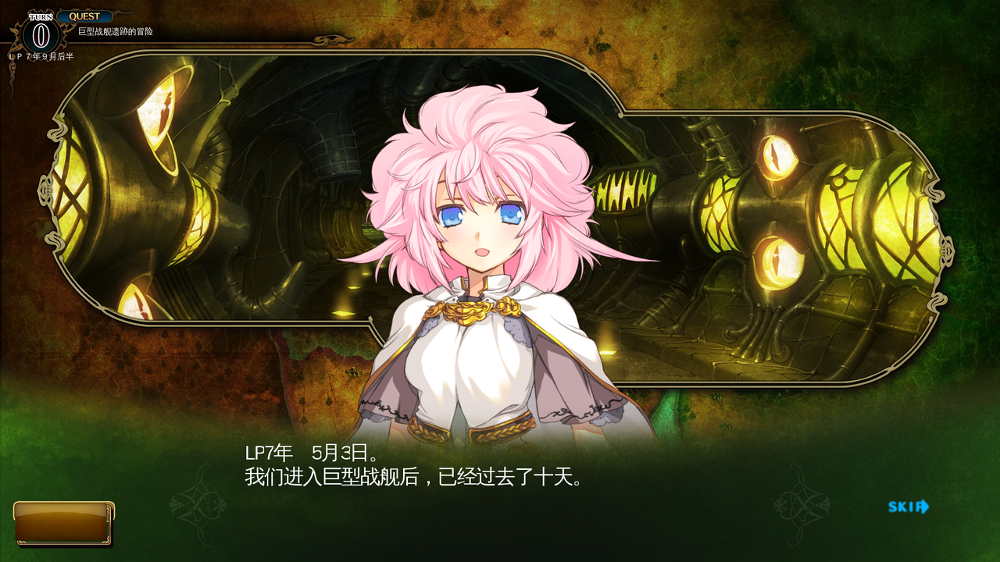

<div align="center">

# 兰斯10 · Linux 原生移植

**让《ランス10》在 GNU/Linux 上原生运行** —— 不走 Wine，不走 proot，不走 box86/box64。

[](https://github.com/easleyclaymore/Rance10-Android-Port/actions/workflows/build.yml)
[](https://github.com/easleyclaymore/Rance10-Android-Port/releases)
[](COPYING)

[现在能跑到哪](#现在能跑到哪) · [下载二进制](#下载预编译二进制) · [从源码编译](#从源码编译) · [运行](#运行) · [文档](#文档地图)

</div>

---

## 这是什么

上游 [nunuhara/xsystem4](https://github.com/nunuhara/xsystem4) 是 AliceSoft **System4** 引擎的
类 Unix 开源实现（C 语言 + SDL2 + OpenGL），能跑不少 System4 游戏，但**跑不动兰斯10**。

本仓库是它的下游分支，做两件事：

1. **把渲染 / 输入 / 音频层从 SDL2 迁到 SDL3**（`main` 就是这条线）。
2. **补齐兰斯10 特有的 AIN v12 字节码语义**：值表示、接口派发、泛型容器、活动（`.pactex`）解析、
   存档格式……上游没有覆盖的部分，这里用反汇编 + 存档文件逐条取证补上。

改动都是**引擎侧**的，游戏文件一个字节都不动。目标平台是 Linux 桌面（x86_64）与 Android（arm64），
当前实际在推进 Linux 桌面。

> **仓库不含任何游戏素材。** 图像、音频、脚本版权归 AliceSoft，需要你自备正版游戏目录。
> 本仓库只包含引擎源码与工具链。

## 现在能跑到哪

```
标题画面
  → 第一章开场 ADV（连续 37 句，可 Ctrl 快进）
  → 回想对话「過後查看」→ 选项 → 地图「部队编制」
  → 第一场战斗：背景 / 双方 HP / Round 1/10 / AP 球 / 技能卡 / 角色卡 / 防御·编成 全部画出来
  → 点角色卡 → 技能列表展开 → 选技能 → 伤害结算（敌方 HP 9000 → 8303 → 7984 …）
  ✗ 技能卡「用鼠标点」这一下仍然点不中 —— 命中盒是 1×1，见下方「当前卡点」
```



> 上图为**未经修图的实机画面**：引擎 `glReadPixels` 直接从 GL 主表面 dump 的 1920×1080 原始帧，缩放到 1280×720。
> 桌面 x86_64 构建，arm64 APK 尚未交付。

**当前卡点**：战斗里「点技能卡」这一跳。AIN 侧的点击链本身是通的
（`ActivityButton` → `LargeSkillButton` → collection → `BattleCardButton` → `SceneBattle@OnClickSkill`），
断在最后一步：`BattleCardButton.m9` 是空委托页（`DG_CALL` 静默跳过），且技能卡的命中矩形被活动加载器
按 EX 里的「尺寸」字段设成了 `1×1`。用确定性驱动直调 `OnClickSkill` 可证明**其后整条战斗逻辑正常**。

> 现状 / 阶段 / 卡点的**唯一信息源**是 [`docs/STATUS.md`](docs/STATUS.md)，
> 未结技术债与已清零索引是 [`docs/TECH_DEBT.md`](docs/TECH_DEBT.md)。
> 本 README 只回答「这是什么、怎么编译、怎么跑」。

## 下载预编译二进制

不想自己编译就看 [**Releases**](https://github.com/easleyclaymore/Rance10-Android-Port/releases)。
每个 `v*` tag 由 GitHub Actions 自动构建 `xsystem4-<tag>-linux-x86_64.tar.gz`
（release 构建、已 strip、约 2.5 MB），**包内自带 SDL3 与 GLEW**，解压即用：

```sh
tar xzf xsystem4-*.tar.gz && cd xsystem4-*
./run.sh /path/to/ランス10        # 目录里要有 AliceStart.ini 与 Rance10.ain
```

包内 `README-RUN.txt` 写了依赖与字体设置，Release 正文写了当版进度与已知问题。

> 项目还在早期，**只发二进制**，不做 deb / AppImage / Flatpak —— 接口和依赖还会变，
> 现在做发行版打包只会变成负担。

## 从源码编译

### 0. 一键

```sh
git clone --recurse-submodules https://github.com/easleyclaymore/Rance10-Android-Port.git
cd Rance10-Android-Port
tools/env/build.sh --check     # 先看缺什么（不会开始编译）
tools/env/build.sh             # 装齐依赖后：meson setup + ninja，产物 build/src/xsystem4
```

`build.sh` 会依次：摘掉 `PYTHONPATH`/`PYTHONHOME` → 确认 `libsys4` 子模块已拉取 →
幂等应用 `patches/*.patch` → 用 pkg-config 检查依赖并打印对应的 apt 包名 → `meson` + `ninja`。
它只是把下面几步串起来，读得懂就不必用它。

### 1. 依赖

Debian / Ubuntu（**24.04 实测，CI 同款**）：

```sh
sudo apt install -y build-essential pkg-config meson ninja-build cmake flex bison \
  libfreetype-dev libffi-dev libpng-dev libsndfile1-dev libturbojpeg0-dev \
  libwebp-dev zlib1g-dev libdeflate-dev libfontconfig-dev \
  libgl-dev libglew-dev libcglm-dev libgles2-mesa-dev
```

| 类别 | 需要 | 备注 |
|---|---|---|
| 工具链 | `gcc` `meson`(≥0.59) `ninja` `pkg-config` `bison` `flex` | `cmake` 只在从源码编 SDL3 时需要 |
| 必装库 | SDL3 ≥ 3.2、freetype2、libpng、libwebp、libturbojpeg、libsndfile、libffi、zlib、libdeflate | 缺任一个 `meson setup` 直接失败 |
| 图形 | **`libglew-dev` + `libgl-dev`** 或 **`libgles2-mesa-dev`** | 二选一，见下方「GL 两条路」 |
| 建议装 | `libfontconfig-dev`（中文版动态找 CJK 字体）、`libcglm-dev`（缺失时 meson 现编 fallback） | |
| 可选 | `libavcodec/format/util/swscale`（视频）、`chibi-scheme`（内置 Scheme 调试器）、`readline` | 缺了对应功能降级，不影响进游戏 |

### 2. SDL3 怎么办

`libsdl3-dev` 只在较新的发行版里有（Debian trixie+ / Ubuntu 25.10+）。分三种情况：

```sh
pkg-config --modversion sdl3    # 有输出就不用管
```

- **有**（≥ 3.2，本项目实测 3.4.20）：跳过。
- **源里有 `libsdl3-dev`**：`sudo apt install libsdl3-dev`。
- **都没有**：从源码装，装到 `/usr/local` 后记得让 pkg-config 看得见：

```sh
curl -fsSLO https://github.com/libsdl-org/SDL/releases/download/release-3.2.28/SDL3-3.2.28.tar.gz
tar xf SDL3-3.2.28.tar.gz && cd SDL3-3.2.28
cmake -S . -B build -G Ninja -DCMAKE_BUILD_TYPE=Release -DCMAKE_INSTALL_PREFIX=/usr/local \
      -DSDL_TESTS=OFF -DSDL_EXAMPLES=OFF -DSDL_SHARED=ON -DSDL_STATIC=OFF
sudo cmake --install build && sudo ldconfig
export PKG_CONFIG_PATH="/usr/local/lib/pkgconfig:$PKG_CONFIG_PATH"
```

> 版本选 **3.2.x**（LTS 线、各发行版打包的那条），不要盲目跟 latest：3.4.x 对 CMake 版本要求更高，
> 而用 3.2 编出来的二进制在别人机器上兼容性更好。CI 也是这个策略，可以用
> `workflow_dispatch` 的 `sdl3_version` 输入临时换版本。

### 3. 构建

```sh
meson setup build --buildtype=release
ninja -C build
./build/src/xsystem4 --version     # 冒烟测试：打印版本后退出，不开窗
```

也可以直接用脚本（同样的命令，多了依赖检查与补丁幂等应用）：

```sh
tools/env/build.sh                    # 默认 build/，release
tools/env/build.sh -d build-sdl3      # 指定目录（本机开发用的就是这个）
tools/env/build.sh -t debug           # 带符号
tools/env/build.sh --gl               # 强制桌面 GL + GLEW（与 Release 二进制一致）
```

**GL 两条路**：`meson_options.txt` 里 `opengles` 默认 `auto` —— 系统有 `glesv2` 就走 GLES，
否则退回桌面 GL + GLEW。两条都能跑。Release 二进制是 `-Dopengles=disabled`（桌面 GL + GLEW），
因为它要在各种老机器上开箱即用。

### 4. 常见坑

| 现象 | 原因 / 解法 |
|---|---|
| `ModuleNotFoundError: No module named 'encodings'` | 桌面环境里 `PYTHONHOME`/`PYTHONPATH` 指向了别的解释器 → `env -u PYTHONHOME -u PYTHONPATH -u PYTHONDONTWRITEBYTECODE ninja -C build`（`build.sh` 已内置） |
| 链接期 `undefined reference to 'ajp_get_metrics'` | `patches/` 里的 libsys4 补丁没打 → `git -C subprojects/libsys4 apply "$PWD/patches/0002-libsys4-ajp-metrics.patch"` |
| `subprojects/libsys4` 是空目录 | clone 没带 `--recurse-submodules` → `git submodule update --init --recursive` |
| `Dependency "sdl3" not found` | 见上一步；源码装的还要 `export PKG_CONFIG_PATH=/usr/local/lib/pkgconfig` |
| 游戏里中文变方块 | 没有 CJK 字体 → 装 `fonts-noto-cjk` 或 `libfontconfig-dev` 相关字体包 |

## 运行

```sh
build/src/xsystem4 /path/to/ゲームディレクトリ
```

游戏目录里至少要有 `AliceStart.ini` 与 `Rance10.ain`（其余 `.afa` / `Data/` 按游戏原样放着）。
引擎会从该目录读取资源；存档写回同一目录。

- `--version` / `--help`：打印信息后退出，**不开窗**，适合在无显示环境做冒烟测试。
- 想在真实桌面上自己玩：`tools/run/run-local.sh <tag> [秒数]`（复用当前 `DISPLAY`，日志写 `logs/local_<tag>.log`）。
- 无头跑测（开发 / CI 用）：`tools/run/run-headless.sh`，自建 Xvfb + 3G 内存上限，不碰你的桌面。

## 跑测与门禁

```sh
python3 tools/check_core_deps.py     # 必须 RESULT: PASS
python3 tools/gen-doc-numbers.py --check
```

- **可移植性门禁**：Core Layer（`vm.c` / `page.c` / `heap.c` / `ffi.c` / `pal.c`）不得出现 Linux-only
  头文件或硬编码绝对路径；平台服务经 `include/pal.h` 注入，Linux 实现在 `src/pal_linux.c`，
  Android 阶段提供 JNI 实现。CI 里跑的就是这一条（`XSYS4_SKIP_DOC_GATE=1`）。
- **跑测**：`tools/run/run-headless.sh` 是唯一入口（`run-live.sh` 会拒绝在真实桌面运行）。
  动作序列语法、日志前缀契约、诊断开关见 [`docs/SDK.md`](docs/SDK.md)。
- **诊断开关**：`XSYS4_*` 环境变量，默认全关；总表由脚本生成，见 [`docs/SWITCHES.md`](docs/SWITCHES.md)。

## 仓库结构

| 路径 | 内容 | 入库 |
|---|---|---|
| `src/`, `include/`, `meson.build` | 引擎源码（VM / 渲染 / HLL 绑定） | 是 |
| `subprojects/libsys4` | 上游子模块（gitlink）+ `patches/` 里的本地补丁 | 是 |
| `tools/` | 构建/跑测脚本、离线分析工具、门禁 | 是 |
| `docs/` | 现状台账、方法论、工具链说明、生成物 | 是 |
| `build*/`, 游戏目录, `logs/` | 编译产物、游戏本体（有版权）、跑测日志 | 否 |

## 文档地图

> 每类信息只有一个源，其余文档只写链接。完整分层见 [`docs/STATUS.md`](docs/STATUS.md) §6。

| 想知道 | 去哪 |
|---|---|
| 现状 / 阶段 / 卡点 / 必读契约 | [`docs/STATUS.md`](docs/STATUS.md) |
| 未结技术债 / 已清零索引 | [`docs/TECH_DEBT.md`](docs/TECH_DEBT.md) |
| 跑测命令、动作序列、日志前缀 | [`docs/SDK.md`](docs/SDK.md) |
| 离线工具（反汇编 / 资源解包 / HLL 普查） | [`docs/OFFLINE.md`](docs/OFFLINE.md) |
| 移植方法论（对外成书） | [`docs/GUIDE/`](docs/GUIDE/) |
| 渲染后端决策（SDL2→SDL3 已落地） | [`docs/RENDER-BACKEND.md`](docs/RENDER-BACKEND.md) |
| 诊断开关总表 / 项目数字（脚本生成，勿手改） | `docs/SWITCHES.md` / `docs/STATS.md` |
| `tools/` 目录分层 | [`tools/MAP.md`](tools/MAP.md) |

## 分支

| 分支 | 用途 |
|---|---|
| `main` | **唯一主线**：SDL3 后端 + 第一章推进，日常提交与推送都在这里 |
| `sdl3` | 已并入 `main` 的等价指针，保留只为旧链接不失效 |
| `rance10-native` | SDL2 时代的完整移植史，只读对照 |
| `main-archive-20261119` | 切主线前的旧快照链存档，只读，可回滚 |
| `upstream` | 上游基线，**只读参考**：不再合并（本分支已走到上游前面） |

## 许可与致谢

- 许可：**GPL-2.0**（见 [`COPYING`](COPYING)），与上游一致。
- 上游：[nunuhara/xsystem4](https://github.com/nunuhara/xsystem4)（引擎骨架）、
  [nunuhara/libsys4](https://github.com/nunuhara/libsys4)（System4 资源格式）。
- 《ランス10》及其全部素材版权归 **AliceSoft**，本项目不提供、不分发任何游戏文件。
