# 兰斯10 官方游戏指南（生成物）

> **由 `tools/gen-manual.py` 从 `Rance10_Port/game/Manual/*.html` 机械转换，禁止手改。**
>
> - **权威源 = 原 HTML + 原图**（`Rance10_Port/game/Manual/`，官方中文说明书）。
>   本目录是派生副本，图片随附在 `img/`；原文有歧义时回看权威源。
> - **版权归 AliceSoft**：仅作本项目内部查验 / 界面对照，请勿再分发。
> - **图内文字未 OCR**：完整按键表（`img/rm01.gif`）、各界面基准
>   （`img/rm*.jpg`、`img/pm*.jpg`）需直接看图；清单见
>   [`../MANUAL-INDEX.md`](../MANUAL-INDEX.md) 的「图片陷阱」。
> - 重跑 `tools/gen-manual.py`；校验 `tools/gen-manual.py --check`。
> - 编码 UTF-8；导航菜单已剥离，章节 / 表格 / 图片相对链接保留。

## 目录

- 封面
- 新手教程
- 指南 01 游戏简介
- 指南 02 ＳＡＶＥ与ＬＯＡＤ
- 指南 03 基本玩法
- 指南 04 游戏流程
- 指南 05 图鉴与帮助按钮
- 指南 06 角色与物品
- 指南 07 部队数据
- 指南 08 准备＆作战环节
- 指南 09 任务
- 指南 10 战斗
- 指南 11 挑战模式与联合部队
- 指南 12 探险小窍门
- 参考 01 基本操作
- 参考 02 启动界面
- 参考 03 ＭＥＮＵ
- 参考 04 收藏界面
- 参考 05 ＬＯＡＤ界面
- 参考 06 事件・剧情界面
- 参考 07 回合开场界面
- 参考 08 准备作战界面
- 参考 09 任务界面
- 参考 10 部队编制界面
- 参考 11 战斗开始界面
- 参考 12 战斗界面
- 参考 13 餐券界面
- 参考 14 设置
- 开发人员
- 版权

---

## 封面

> 源文件：`index.html`

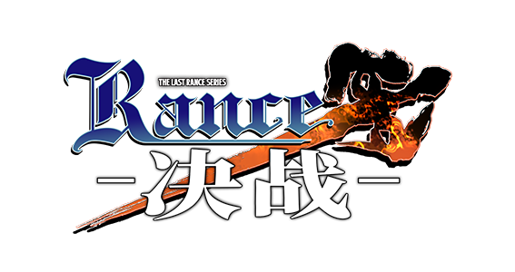

### ＜兰斯１０ 游戏指南＞

2018.02 ver.

请从左边菜单选取希望阅览的条目。

　
 ※本指南含有JavaScript脚本。
若浏览器提示［系统已禁止此网页执行JavaScript或ActiveX代码。］
请选择［允许网页执行JavaScript和ActiveX］。

| 前往兰斯１０官方网站 | 前往AliceSoft官方网站 |
|---|---|

---

## 新手教程

> 源文件：`startup.html`

■新手教程■

| ● 游戏启动方法 ● 游戏卸载方法 ● 保障范围 ● 禁止事项 ● 关于本游戏 ● 操作方法 ● 游戏无响应的情况 ● 存档数据位置相关 ● 更改窗口大小相关 ● 全屏时的画面比例相关 ● 画面的放大方法相关 ● 窗口设定的初始化方法 ● 版权 ● 联系方式 ● 网页相关 |
|---|

■

### 游戏启动方法

Windows7:
 打开开始菜单中的「所有程序」，并依次点击「AliceSoft」→
 「兰斯１０」→点击「兰斯１０」打开游戏。

Windows8/8.1:
 右键点击开始界面无磁贴处→点击「所有程序」，
 或选择画面左下的(↓)按钮展开应用程序列表画面，
 点击「兰斯１０」打开游戏。

Windows10:
 打开开始菜单的「所有应用」，并依次点击「AliceSoft」→
 「兰斯１０」打开游戏。

### 游戏卸载方法

打开控制面板的「卸载程序（程序和功能）」，选择
 「兰斯１０」进行卸载。

### 保障范围

敝公司游戏软件经过严密检查排除故障，
 但不保证１００％不出现错误。
本游戏软件在多种不同ＰＣ上经过确认可正常运行，
 但不保证所有ＰＣ都可正常运行。

对于以下类似情形，敝公司不能给予售后保障。

・游戏时出现精神上的不舒适。
・进行游戏时出现硬件或软件等方面的
　故障（硬盘数据丢失等）。

敝公司游戏软件中并未内嵌删除硬盘数据的程序，
 但由于驱动程序故障及内存不足等原因，
 可能在极少数情况下导致Windows死机，
 造成硬盘数据丢失。

### 禁止事项

除版权例外情况，禁止复制&篡改&录音&录像&转载&出租&变相出租&散布&传播
 本作品的部分或全部内容。

### 关于本游戏

本游戏故事内容纯属虚构，
 其中登场的所有人物、物品、名称等均非实际存在。

同时，游戏中登场的一切亲属关系（血缘关系）
 均为虚构且属于非直系亲属关系。

### 操作方法

【窗口菜单】

系统
　　・图像保存
 　　　　将当前游戏画面保存为BMP、JPEG文件。
　　　　保存下来的图像可通过Windows附带的画图等软件进行浏览。
　　・回到标题界面
 　　　　中断游戏返回标题界面。当前游戏进度可能不会被保存，
 　　　　请多加注意。
　　・关闭游戏
 　　　　结束游戏。

帮助

　　・游戏指南
 　　　　打开本指南。

　　・版本情报
 　　　　显示当前游戏的版本信息。

【标题栏】

　　

：最小化窗口。
 　　

：切换全屏或窗口显示。
 　　

：结束游戏。

### 游戏无法正常运行时

安全软件等常驻软件正在运行时，
 可能造成游戏无法运行。
如果运行不正常，请关闭此类软件重新启动游戏。

### 存档保存路径

保存存档数据的文件夹会在首次启动游戏后创建。

存档文件夹的位置会根据安装时的设定而有所不同，
 默认保存位置为「文档」文件夹下的
 「AliceSoft」→「兰斯１０」文件夹内。

游戏将为每一个用户账户创建存档文件夹。
 另外，即使游戏被卸载，各个用户账户中的
 存档文件夹都将被保留。

### 更改窗口位置／大小

在窗口模式下，可通过拖动窗口边框
 来更改窗口的大小。

窗口显示位置可通过拖动标题栏进行更改。

勾选游戏设定→窗口设定中的「下次启动时还原窗口位置和大小」，
 即可保存当前设定。

### 关于全屏时的画面比例

通过将设置→窗口中的「全屏时的画面比例」设为「固定」，
 可在游戏画面比例与显示器不同时，
 保证游戏画面以正确比例显示。

### 关于画面的放大方法

全屏模式下进行游戏或变更窗口大小后，
 游戏默认将以「双三次插值」算法进行缩放处理。

通常情况下此设置可使游戏正常显示，若出现画面混乱、延迟等
 画面显示问题，可通过将「设置」→「窗口」中的
 「放大方法」改为「标准」，尝试解决上述问题。
但此时画质将有所下降（图像锐利度将下降）。

### 窗口设定的初始化方法

更改游戏设定→窗口设定后，若游戏不能正常启动，
 可通过任务栏以及任务管理器等确认游戏已关闭后，
 删除存档文件夹内「SaveData」文件夹中的「WindowSetting.sav」，
 以还原初始设定。

删除后，请先重启Windows再尝试启动游戏。

### 版权

Microsoft Windows及Microsoft DirectX是美国Microsoft Corporation
 在美国以及其他国家的注册商标。其他被记载的公司名以及
 商品名均为各个注册公司的商标以及注册商标。

本软件日文所使用的字体，是基于フォントワークス股份公司的字体，
 配合软件设计制作而成。
フォントワークス的公司名フォントワークス、Fontworks，以及字体的名称，
 是フォントワークス股份公司所有的商标或注册商标。

Ogg Vorbis is Copyright(c)2001,xiphophorus.
 All right reserved.

This software is based in part on the work of the independent JPEG Group.

### 联系方式

邮政编码　530-0043
 地址　　　大阪府大阪市北区天満3-12-3　ハニービル
 　　　　　アリスソフト
 联系方式　　http://www.alicesoft.com/contact/index.html

在咨询软件运行问题前请先参阅以下的网址。
客户支持服务　http://www.alicesoft.com/support/

※恕不答复有关游戏攻略提示、内容等问题。
※恕不答复有关存档数据的保存&移动等问题。
　咨询时请客户自行承担相关责任。
※本公司不对二手购买或是复制得来的软件提供售后服务支持。

### 关于网页

如果想知道最新作品的信息，或Alice Soft的相关信息等，
 请浏览本公司网站：

　　　　http://www.alicesoft.com/

服务内容
 ・本公司新产品的信息
 ・更新数据下载服务
 ・其他供客户体验的企划等等

※各项企划均会经常进行改良或更改。您可直接在公司网站上
 　查阅到您使用相关产品时本公司正在提供的服务内容。

---

## 指南 01 游戏简介

> 源文件：`01.html`

### 1．游戏简介

感谢您购买兰斯１０。

■

遭到魔军入侵的人类深陷灭亡的危机之中。
兰斯将统领全人类对抗魔军。

本作是兰斯系列自《兰斯 －寻光－》以来的
 最后一部作品。

■

---

## 指南 02 ＳＡＶＥ与ＬＯＡＤ

> 源文件：`02.html`

### 2．ＳＡＶＥ与ＬＯＡＤ

玩家可以对游戏进程进行 ＳＡＶＥ（保存）及ＬＯＡＤ（读取）。

ＳＡＶＥ功能分为在游戏进行时自动进行保存的「自动ＳＡＶＥ」，
 及可在任意时间由玩家手动操作的「手动ＳＡＶＥ」两种形式。

▲ 回到页首

■

### 2-1．ＳＡＶＥ

游戏中最多可建立100个存档。

当存档数量达到最大值时，请先删除不需要的数据，
 然后再进行ＳＡＶＥ操作。

可进行ＳＡＶＥ的时间点

　　・任务进行时
　　・回合开始时
　　・准备环节
　　・作战环节
　　・据点环节

※　战斗时、剧情会话时无法进行ＳＡＶＥ

自动ＳＡＶＥ

在游戏中，游戏会在如下时间点自动进行ＳＡＶＥ操作。
但自动ＳＡＶＥ经常会对数据进行覆盖，如需要保存游戏数据，请使用手动ＳＡＶＥ功能。

自动ＳＡＶＥ时间点

　　・回合开场前
　　・准备环节
　　・作战环节
　　・据点环节
　　・任务内的选项分歧点
　　・任务内战斗前

▲ 回到页首

■

### 2-2．ＬＯＡＤ

ＬＯＡＤ功能可从「自动ＳＡＶＥ」或「手动ＳＡＶＥ」记录的数据中
 重新读取游戏进度。

可以进行进度读取的时间点

　　・游戏启动后
　　・任务进行时
　　・新回合开始时
　　・准备环节
　　・作战环节
　　・据点环节
　　・游戏失败后
　　・战斗前、战斗时、剧情会话时

▲ 回到页首

■

---

## 指南 03 基本玩法

> 源文件：`03.html`

### 3．基本玩法

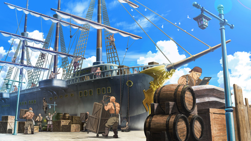

兰斯10的游戏难度较高，

首次游戏时极难彻底攻略完成所有游戏内容，
 且有很大可能进入无法拯救世界的通关路线。

这类路线可被视为BAD END，玩家可以吸取失败经验，
 在后续的重新挑战中进入真正的通关路线。

| 从头开始游戏 ▼ 通关某条剧情路线 ▼ 再次重新开始游戏 （根据此前达成的成就，可获得某些有利条件） ▼ 最后完成真通关路线 |
|---|

［要点］

兰斯10中，玩家无法像通常的RPG游戏一样停留在某一个地点赚取经验。
若在游戏过程中得到不称心的结果，请勿在中途中止游戏重新开始，
 而是继续走到某个结局。

游戏中每次通关（达成某个结局）后都将获得成就。
拥有成就后，即可使用对游戏有利的ＣＰ加成。

　成就的查看方式
 　　　　[ＭＥＮＵ]　→　[收藏]　→　[成就]

同时，通关后将解锁「挑战模式」及「联合部队」。
　⇒　[挑战模式与联合部队]

▲ 回到页首

■

---

## 指南 04 游戏流程

> 源文件：`04.html`

### 4．游戏流程

游戏将以回合形式推进。

１回合相当于游戏内的约２周时间。
　⇒　[资料：回合]

▲ 回到页首

■

### 4-1．回合与环节

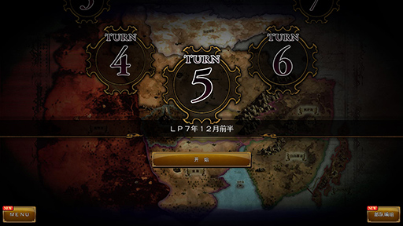

每个回合将由以下环节构成。

[回合开场环节]

本环节内可能自动出现新任务。

[准备环节]

可在该环节中选择一个任务进行行动。
准备环节中的任务难度较低，可视为作战环节前的热身。

[餐券使用环节（第一次）]

拥有餐券时会触发此环节。

[作战环节]

可在该环节中选择一个任务进行行动。
本环节中的任务为正式的大规模作战。作战环节属于本游戏的主要部分。

[餐券使用环节（第二次）]

拥有餐券时会触发此环节。

[据点环节]

可在该环节中选择一个任务进行行动。
据点环节中的主要内容为作战结束后，兰斯在据点做的某些（？）事情。

[回合结束环节（第一次）]

本环节内可能自动出现新任务。
主要内容为兰斯一行之外的人类方剧情。

[战况环节]

本环节将展示该回合内各地区的战斗结果。

[回合结束环节（第二次）]

本环节内可能自动出现新任务。
主要内容为魔军方剧情。

[勇者环节]

本环节中，玩家将看到世界人口减少情况及正在关注这一切的勇者。

▲ 回到页首

■

### 资料：回合

≪ＬＰ历≫
 魔王小公主（美树）诞生以来的魔王历。

| ＬＰ１年 | ■兰斯１ －寻光－： ■兰斯２ －反叛的少女们－： |
|---|---|
| ＬＰ２年 | ■兰斯３ －利萨斯陷落－： ■兰斯４ －教团的遗产－： ■兰斯５Ｄ－孤身一人的女孩－： |
| ＬＰ４年 | ■兰斯６ －赛斯崩溃－： |
| ＬＰ５年 | ■兰斯７ －战国兰斯－： |
| ＬＰ６年 | ■兰斯８ －兰斯・Quest－： ■兰斯９ －赫尔曼革命－： |
| 以及… | ■兰斯１０：第１回合 ＬＰ７年１０月上半月 第２回合 ＬＰ７年１０月下半月 第３回合 ＬＰ７年１１月上半月 第４回合 ＬＰ７年１１月下半月 第５回合 ＬＰ７年１２月上半月 第６回合 ＬＰ７年１２月下半月 第７回合 ＬＰ８年１月上半月 第８回合 ＬＰ８年１月下半月 第９回合 ＬＰ８年２月上半月 第１０回合 ＬＰ８年２月下半月 第１１回合 ＬＰ８年３月上半月 第１２回合 ＬＰ８年３月下半月 第１３回合 ＬＰ８年４月上半月 第１４回合 ＬＰ８年４月下半月 第１５回合 ＬＰ８年５月上半月 第１６回合 ＬＰ８年５月下半月 |

无论游戏路线如何，游戏都将在第16个回合结束。

▲ 回到页首

■

### 4-2．兰斯等人的使命

兰斯该做的以及他想做的事，
 本来当然是和可爱的女孩子上床……

1．从魔军的进攻中保护人类地区

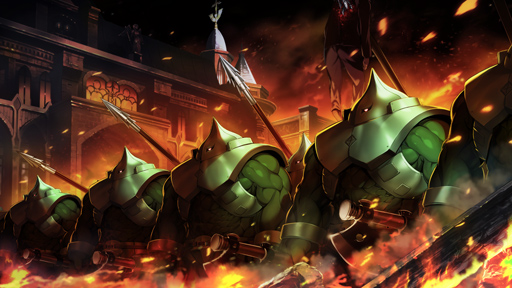

利萨斯、赫尔曼、赛斯、自由都市四个地区将同时遭到进攻。
兰斯必须率特殊部队进行支援，但他无法同时支援所有地区。
行动时需要深思熟虑。
当以上所有地区均被魔军占领，则人类失败。

2．救助未魔王化的美树

未成为魔王的美树正躲藏在某地。
兰斯需要找出美树并施以援手。
如果美树觉醒成为魔王……人类就失败了。

3．阻止勇者狄欧曼

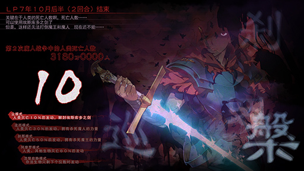

勇者的剑——埃斯库多之剑，
在人类危机越是深重时，这把剑将发挥出更大的力量。

　　３０％的「人类死亡率」可使其得到杀死魔人的力量。
　　５０％的「人类死亡率」可使其得到杀死魔王的力量。

勇者为了得到杀死魔王的力量，
 决心等待人类的死者人数上升。甚至是主动助长人类死亡数上升。

当然，兰斯必须阻止他的行为。

▲ 回到页首

■

### 资料：行动补充

★本资料推荐在对游戏有一定掌握后阅读。

1．从魔军的进攻中保护人类地区

各个地区的人类军兵力变为0时，该地区将被魔军占领。
玩家需要对此采取措施。

通过兰斯的介入（准备作战环节中选择任务）

可在所选地区取得「战果」。

只要有一个战果，都会为战果所属地区带来可观的影响。
　・该地区军队损失减半
　・人类死亡率上升减半

此外，如果魔军方正在针对某地区准备「大规模作战」，则状况将十分危险。
如果不及时通过为该地区获取战果等方式采取对策，地区将有可能直接遭到占领。
（但如果地区兵力悬殊已经太大，则玩家的行动也可能无济于事……）

2．救助未魔王化的美树

游戏中通篇存在的一个巨大障碍，
就是美树觉醒成为魔王造成游戏结束。
玩家可能会多次看到世界被魔王毁灭的结局。

因此在进行游戏时请时刻注意魔王的动向以及所在。
尽管战争期间兰斯等人几乎没有时间关心其他事，但也不要忘记关注。

3．阻止勇者狄欧曼

战争开始后的「人类死亡率」万分重要，
当这一数字超过５０％，勇者便会剑指魔王，
 而其结果对人类而言并不会算得上可喜可贺。

兰斯等人需要采取行动避免「人类死亡率」增长。

基本上，需要做的事情与１．从魔军的进攻中保护人类地区　相同，
 但如果地区战况恶化，该地区人类军即使没有全灭，保护平民的工作也将难以进行，
 平民死亡人数将会增加。
在被魔军占领后，「人类死亡率」将呈爆发式增长。
同时，只要战争仍在持续，「人类死亡率」便会一直增长。

防止地区遭到占领、尽早结束战争，这两点尤为重要。

▲ 回到页首

■

---

## 指南 05 图鉴与帮助按钮

> 源文件：`05.html`

### 5．图鉴与帮助按钮

游戏进行时可通过点击「帮助」按钮，
 阅览与当前界面内信息相关的说明。

图鉴中集合了兰斯系列的故事背景设定，也请务必一读。

▲ 回到页首

■

### 5-1．图鉴

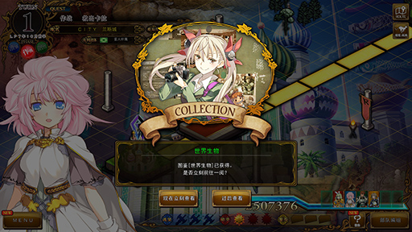

玩家将通过「图鉴」形式不时获得一些与兰斯系列故事设定有关的信息。

　　　　[ＭＥＮＵ]　→　[收藏]　→　［图鉴］

图鉴并非必须阅览的内容，但努努赫拉会在其中进行热心的讲解？
 相信值得一阅。

▲ 回到页首

■

### 5-2．帮助

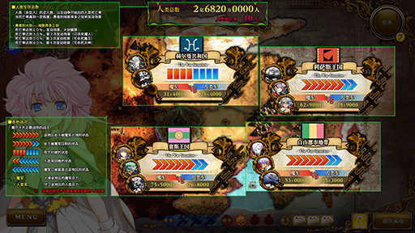

游戏中的一些界面内会包含[帮助]按钮。
帮助中将介绍一些当前界面的信息等内容，如果发现帮助按钮，可以尝试点击阅览。

帮助按钮的出现位置

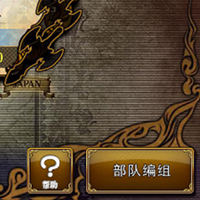

| ・任务界面 ・ＭＥＮＵ界面 ・战斗界面 ・餐券使用界面 ・准备作战界面 ・地区选择界面 ・部队加成界面 ・部队编制界面（显示角色卡片时） ・部队编制界面（显示角色卡片详情时） |  |
|---|---|

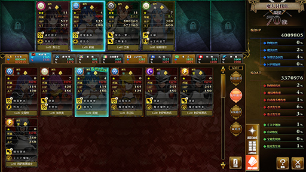

角色信息可通过点击详情按钮查看。
玩家可随时进行查看。

战斗中，将光标对准界面上的图标可显示相关详情。

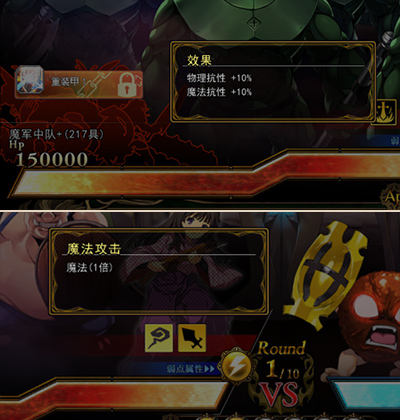

　　支援状态　　　帮助敌方或我方战斗的援军
　　异常状态　　　正对敌方或我方产生影响的异常状态
　　敌方行动　　　敌方将在下一轮采取的行动

▲ 回到页首

■

---

## 指南 06 角色与物品

> 源文件：`06.html`

### 6．角色与物品

本作中，角色及物品均将以卡片形式代表。

▲ 回到页首

■

### 6-1．卡片详情

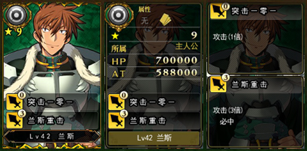

|  |  |  |
|---|---|---|
| 卡片表 | 卡片详情１ | 卡片详情2 |

角色名字

角色固有的名字。

技能１、技能２

每个角色最多持有２个技能。
也有部分角色不持有技能。

属性

角色拥有以下几种属性
　　　●＝无
　　　●＝炎
　　　●＝冰
　　　●＝雷
　　　●＝光
　　　●＝暗

所属

所有角色均属于以下１０个团体之一。

　　主人公、利萨斯、赫尔曼、赛斯、自由都市
　　其他、ＪＡＰＡＮ、亚人、怪物、神魔

★级别

表示角色成长度的数值。
级别与等级不同，用于表示「战斗熟练度」。

重叠级别

初始状态下不会有重叠级别，当玩家获得同一卡片，
 重叠级别将会按照获得同一卡片数量以数字形式表示。

ＨＰ

即体力。
ＨＰ值会随★级别・重叠级别上升而增加。

ＡＴ

即攻击力。
ＡＴ值会随★级别・重叠级别上升而增加。

▲ 回到页首

■

### 资料：角色成长与物品提升

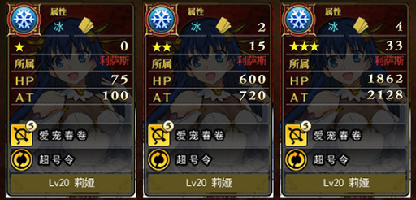

角色成长方式

　　・提升「★级别」
　　・提升「重叠级别」
　　・收集「同一角色的其他卡片」

玩家可通过这三种方式提升角色能力。

★级别

★级别与通常的等级、经验值系统类似，并可不断提升。
　　１．作为领队编入队伍参与战斗
　　２．自动战斗时被选中参与战斗
　　３．餐券环节时被选中

达到级别１０时，角色能力将大幅上升，变为★★级别。
达到级别２０时，角色能力将大幅上升，变为★★★级别。
达到级别４０时，角色能力将大幅上升，变为★★★★级别。
达到级别８０时，角色能力将大幅上升，变为★★★★★级别。

培养角色时，以上述等级阶段作为参考目标将获得更大成效。
例如可将角色级别统一升至★★★……

同时，部分「同一角色的其他卡片」需要在角色级别到达★★★等阶段时，
 才可在通过宝箱获取卡片时得到。

提升重叠级别

重叠级别可在获取相同卡片时上升。
重叠级别提升可使角色ＡＴ及ＨＰ各提升１０％。
相同卡片最多可重叠１０张，并提升１００％的ＡＴ及ＨＰ。

※　部分卡片可能无法获取相同卡片。

同一角色的其他卡片

除「Lv42 兰斯」兰斯外，玩家还可获取「Lv45 兰斯」、「Lv55 兰斯」等
 不同版本的卡片。
每张卡片的ＡＴ、ＨＰ等基本能力以及技能各不相同，
 可根据不同作战需求区分使用。

此外，同一角色的「★级别」将在所有卡片中共通。
当角色「★级别」已经提升至很高时，此时若获取到「同一角色的其它卡片」，
 角色能力将得到维持，也可成为部队编制时大幅提升ＡＴ及ＨＰ值的
 因素之一。

物品提升

所有物品共享同一★级别。
★级别提升后获得的物品也将共享同等级别。

物品无法像角色一样配置到领队位置，因此无法通过战斗获得经验值。
作为替代，在任务中每次接触「物品ＵＰ」即可使物品的★级别上升1级。
收集物品越多，得到的增益效果就越多。
同时，玩家还可以通过使用"全物品★強化"这一部队加成来获得成倍的增益效果。

▲ 回到页首

■

### 资料：技能

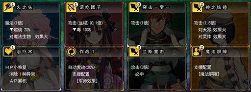

|  | ●攻击(物理攻击) 基础攻击技能。 |
|---|---|
|  | ●魔法(魔法攻击) 基础攻击技能。 |
|  | ●恢复行动（恢复类） 此类行动会对己方成员产生效果。以恢复类技能为主。 |
|  | ●支援行动（支援类） 此类行动会对己方成员产生效果。以支援类技能为主。 |
|  | ●妨碍行动 此类行动对敌方产生效果。 |
|  | ●自动行动 玩家无法自行选择此类行动。 自动行动将在战斗时被自动触发。 |
|  | ●状态ＵＰ 玩家无法自行选择此类行动。 只要相关技能被配置在队伍中即可产生效果。 |

攻击类

攻击(nn倍)

基础攻击技能。
攻击力为领队ＡＴ的nn倍。

魔法(nn倍)

基础攻击技能。
攻击力为领队ＡＴ的nn倍。

<nn%>

技能发动成功率。
技能发动失败时，画面中会显示ＭＩＳＳ，技能将不产生效果。

(远程)

使用发射类武器进行的攻击。
远程攻击可以命中距离较远的敌人，但在狭窄处使用时攻击力将会下降。

必中

攻击将百分百命中。
但在遇到特殊的回避处理或条件时无法发挥效果。

命中率+nn%

命中率＝　１００％　－　敌方回避率　＋　命中率

游戏中的攻击命中率基础值均为100%，
 而在敌方拥有一定回避几率时，此类行动便可发挥效果。

n连击

一次发动n次普通攻击。
但同时有「连击」效果生效时，效果不会叠加。

▼诅咒 nn%

▼毒 nn%

▼混乱 nn%

▼虚弱 nn%

▼黑暗 nn%

▼沉睡 nn%

▼反再生 nn%

▼燃烧 nn%

▼冰冻 nn%

▼触电 nn%

为敌方施加各种异常状态。
nn%为施加成功率。
但在敌方拥有"异常状态抗性"时，施加成功率会成正比下降。

对ｎｎｎ 效果大

敌方对手为ｎｎｎ时，可对其造成１００％的额外伤害。

　　头目　　敌方核心或特殊角色等较难打倒的对手
　　少数　　规模小于平均的敌方部队
　　大军　　规模大于平均的敌方部队

　　其他、哈尼、魔物兵、植物等

属性：ｎ

技能附带有炎、冰、雷、光、暗，几类属性。
若技能属性与领队属性不同，则攻击时将会同时附带两种属性。
若攻击属性与敌方弱点属性相同时，攻击将额外造成１００％伤害。

强化

发动后，将使随机一名角色得到强化。

ＣＯＭＢＯ＋n

通常情况发动普通攻击会使ＣＯＭＢＯ值＋１点，
 而在使用此技能时可使ＣＯＭＢＯ值额外增加n点。

行动阻止 nn%

随机阻止敌方行动。

暗杀 nn%

可让敌方全灭。
nn%为施加成功率。

自爆

发动后，友军将收到伤害。

支援配置　ｎｎｎ

为己方增加支援状态。
但当支援状态已有7个以上时将不会有效。
相同支援不会被重复添加。

排除敌方支援n

随机消除ｎ个敌方拥有的支援状态。
但不能消除带有无法去除标记的敌方支援。

排除敌方支援　ｎｎｎ也包含在内

可以消除一部分带有无法去除标记的敌方支援状态。
　　如风暴、防御设施、魔法、重装甲等

恢复类

消除n种异常

随机消除ｎ个己方异常状态。

恢复ＨＰ

恢复己方ＨＰ

　　小恢复　　恢复约等于５０％领队ＡＴ的值
　　中恢复　　恢复约等于１００％领队ＡＴ的值
　　大恢复　　恢复约等于２００％领队ＡＴ的值

ＨＰn%恢复

恢复己方ＨＰ。
恢复量为相对于最大ＨＰ的相应百分比值。

ＡＰｎ恢复

恢复ＡＰ。

其他

"(Ｒｏ*nn%)

该行动的攻击力为
 当前战斗轮数　×　领队ＡＴ的n％。

※战斗持续轮数越多则该行动攻击力越强

"眩晕与DOWN 无效

对象角色在战斗中不会进入眩晕或DOWN状态。

"战斗强制平局

超过限制时间后，战斗会强制以平局形式结束。

"级别ＵＰ(nn上限)

随机提升一位角色的条件★级别，直到条件限制的值ｎｎ为止。

“DOWN发生时　优先由自己承受"

己方受到敌方攻击陷入DOWN状态时，持有该技能的角色将代替
 受攻击的领队角色进入DOWN状态。

ＡＰ累积

每次使用都会造成技能所需ＡＰ＋１。
可通过任务中的恢复标记复原。

“限制１次

该技能只可使用一次。
可通过任务中的恢复标记使技能恢复为可用。

"行动后＝DOWN

发动后，使用该技能的领队进入DOWN状态。

“条件　ｘｘｘ

带有该表述时，技能将无法在未满足相应条件时使用。

　　例
　　“ＣＯＭＢＯ０"　　　仅当ＣＯＭＢＯ显示为０时可使用
　　"全裸５以上”　　　　仅在全裸角色达５人以上时可使用
　　"敌方HP20%以下"　仅在敌方ＨＰ剩余２０％以下时可使用
　　"除头目以外"　　　　仅可对除头目之外的敌方使用
　　"敌方HP最后一位７"　仅当敌方ＨＰ最后一位数为７时可使用
　　等

自动效果

领队配置效果 回避率 +20

领队配置效果 魔法抗性 +20

领队配置效果 物理抗性 +20

领队配置效果 物理抗性 +20

领队配置效果 物理增伤率 +20

领队配置效果 物理增伤率 +20

领队配置效果 魔法增伤率 +20

领队配置效果 命中率 +20

领队配置效果 自动恢复 +20

只需将拥有这些技能的角色配置到领队位置即可获得效果。
技能产生的效果与战斗中添加支援的效果相同。

※进行战斗计算时，仅效果最高的支援会被计入。

领队配置效果　ｎｎｎ抢攻

ｎｎｎ将有５０％的几率发起抢攻。
与部队状态中的"抢攻发生率"触发的抢攻互不干扰。

领队配置效果　一般战斗全部变成自动战斗

将所有战斗变为自动战斗。
（头目战除外）

领队配置效果　自动战斗全部变成一般战斗

将所有自动战斗变为一般战斗。

领队配置效果　显示敌方弱点

战斗时敌方将始终暴露弱点属性。
通常情况下战斗时敌方有５０％几率暴露弱点，
 此外，根据敌人不同或敌方行动不同可能出现敌方无弱点属性
 的情况，此时该技能不生效。

自动战斗效果　经验值２倍　伤害减半

自动战斗效果　经验值３倍　伤害无效

自动战斗时，若持有该技能角色上场即生效。

支援类

伤害 +nn 对方同时拥有军师效果时，双方效果将互相抵消

军师效果。
可在攻击时附加ｎｎ％额外伤害，
 但在敌方拥有同样效果时将被抵消。

　　例
　　己方　军师效果４（伤害＋４０％）
　　敌方　军师效果１（伤害＋１０％）

此时己方进行攻击时，伤害将只增加３０％。
同时，敌方的伤害加成将变为０％。

餐券出现

在该技能支援状态下结束战斗时，
 可获得一张「餐券」;。
出现宝箱时，宝箱中将必定出现餐券。

特殊物品出现

在该技能支援状态下结束战斗时，
 可获得「敌方拥有的特殊物品」。
出现宝箱时，宝箱中将必定出现餐券。

捕获对象出现

在该技能支援状态下结束战斗时，
 将获得"可作同伴的怪物"。
出现宝箱时，宝箱中将必定出现餐券。
另外，玩家仅可通过这一方式获得女孩怪物。

毒效果ＵＰ

提升由毒造成的伤害。
对敌我双方均产生效果。

状态类

部队编制效果 ◆ｎｎｎｎ +n

当拥有该技能的角色被编入部队，即可发挥效果。
不需要角色为领队。

物理抗性

魔法抗性

异常状态抗性

ＨＰ增加率

物理增伤率

魔法增伤率

自动战斗增伤率

必杀发生率

连击发生率

自动恢复

抢攻发生率

ＥＸＰ增加

宝箱发现率

对象部队能力值提升ｎ％。

部队编制效果　宝箱稀有率ＵＰ

当拥有该技能的角色被编入部队，即可发挥效果。
不需要角色为领队。
宝箱出现时，从中出现稀有的几率上升。

部队编制效果　与包括女孩Ｍ的群体　接触的概率ＵＰ

当拥有该技能的角色被编入部队，即可发挥效果。
不需要角色为领队。
提升与包含女孩怪物的敌方集团遭遇的几率。

部队编制效果　神签运ＵＰ

当拥有该技能的角色被编入部队，即可发挥效果。
不需要角色为领队。

科潘彤持有技能"神签"

　　大凶　　对友军造成１０％伤害
　　凶　　　１名角色进入DOWN状态
　　小吉　　恢复５％ＨＰ
　　中吉　　攻击(１倍伤害)
　　大吉　　攻击(３倍伤害)
　　超大吉　攻击(４倍伤害)、COMBO５

该结果将在阶段1基础上变化。

持久生效　领队的ＡＴ与ＨＰ变为　ｎ倍

角色持有该技能时即可生效，无需编入部队。
配置为领队的角色ＡＴ与ＨＰ将按照ｎ倍进行计算。

仅敌方拥有的效果

DOWN x名

发动时，x名角色将进入DOWN状态。

眩晕 xx%

发动时，角色将进入眩晕状态。
xx%为成功率。

ＡＰ消灭

玩家的当前持有ＡＰ将变为０。

受到攻击时　使用反击回击

玩家攻击敌方时，自身将受到１／３的攻击伤害。

伤害ｎｎ以下完全防御

玩家的１次攻击造成伤害为ｎｎｎ以下时，则攻击伤害变为０。

▲ 回到页首

■

---

## 指南 07 部队数据

> 源文件：`07.html`

### 7．部队数据

本游戏的战斗方式为团体战。
玩家最多可以率领成员超过１００人的魔人讨伐队，与敌方战斗。

▲ 回到页首

■

### 7-1．部队编制

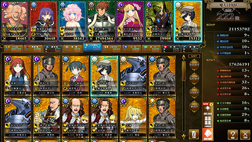

可在多达７个（最开始为４个）领队位置中部署领队。

每一团体可允许一个领队出战。
物品无法部署至领队。

在战斗中，领队并非单枪匹马。
 其所属团体中的所有成员都将以领队为中心参与战斗。

因此，领队的战斗力由以下部分构成。

　　领队的ＡＴ　＝　领队自身ＡＴ的５倍　＋　所属团体所有成员的ＡＴ合计值
　　领队的ＨＰ　＝　领队自身ＨＰ的５倍　＋　所属团体所有成员的ＨＰ合计值

领队本人的ＡＴ、ＨＰ将在
 物品卡片「高级牛车」的技能「领队增益５」的作用下，增加至５倍。

［要点］

未部署到领队位置的角色ＡＴ、ＨＰ也将被计入总数。
 因此如果想让部队更强，可以进行以下操作。

　　・尽可能多地收集角色与物品
　　・对各个角色进行培养

▲ 回到页首

■

### 7-2．部队状态

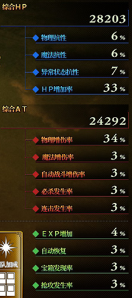

此处可以查看魔人讨伐队在当前编制下的综合状态数据。

综合ＨＰ

显示整个部队的体力。
综合ＨＰ为最多７位领队的ＨＰ值合计。

综合ＡＴ

显示整个部队的攻击力。
该值将作为自动战斗时的攻击力，但在普通战斗中无效。

物理抗性

魔法抗性

异常状态抗性

物理增伤率

魔法增伤率

自动战斗增伤率

必杀发生率

连击发生率

ＥＸＰ增加

自动恢复

宝箱发现率

抢攻发生率

以上参数均为战斗和探险时带来增益的效果。
当一个团体中有角色被编入部队时，团体中的全部角色所持有的「部队编制效果」
 都将生效。

即使某一团体在攻击力上有所欠缺，若该团体内角色拥有
 效果出众的「部队编制效果」，那么将其角色为领队便是十分有价值的。

▲ 回到页首

■

### 资料：部队状态详情

物理抗性

受到敌方的物理攻击时，将按百分比减少伤害。

魔法抗性

受到敌方的魔法攻击时，将按百分比减少伤害。

异常状态抗性

被敌方施加异常状态时，将按此百分比减少陷入异常状态的几率。

ＨＰ增加率

「综合ＨＰ」将按百分比增加。
显示在部队状态中的「综合ＨＰ」为计入百分比后的值。

物理增伤率

向敌方发动物理攻击时，将按百分比增加攻击力。

魔法增伤率

向敌方发动魔法攻击时，将按百分比增加攻击力。

自动战斗增伤率

自动战斗时，将按百分比增加攻击敌方造成的伤害。

必杀发生率

在每一轮战斗中，
 将有相应百分比几率触发必杀效果，使伤害增加１００％。

连击发生率

在每一轮战斗中，
 将有相应百分比几率触发连击效果，使相同技能连续发动两次。

自动恢复

在每一轮战斗中，
 将有相应百分比几率触发恢复效果，使ＨＰ恢复最大值的１０％。

※　该效果不会连续两轮出现
 ※　１次战斗最多出现３次
 ※　仅在战斗持续４轮及以上时才会出现

抢攻发生率

在每一轮战斗中，
 将有相应百分比几率触发，出战团体中的某个角色将自动发起攻击。

ＥＸＰ增加

战斗后将额外获得相应百分比的经验值。

宝箱发现率

战斗后得到宝箱几率将提升相应百分比。

此外，部队状态中的每一项数值的上限均为　４９％。
使用部队加成中的「上限解除」，可使该上限提高至　９９％。

▲ 回到页首

■

---

## 指南 08 准备＆作战环节

> 源文件：`08.html`

### 8．作战环节

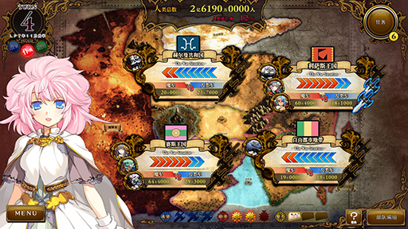

在准备环节和作战环节，
 各可以选择一项任务以推进剧情。

有２种选择任务的方法。

[利萨斯、赫尔曼、赛斯、自由都市]

　　先选中某个地区，再选择该地区的任务。

[任务]

　　从当前列出的所有任务中选择一项。

可在上述任意一个界面中进行选择。

选择任务时可看到的信息

| 作战 | 为保护人类而在各地开展的军事行动。 |
|---|---|
| 大作战 | 包含讨伐魔人等内容的长时间军事行动。 |
| 探险 | 不仅包括军事作战，也包括前往世界各地 进行以拯救世界为最终目的的必要探索。 |
| 单独 | 上述以外的其他行动。如无法进行作战或探险时的突发任务， 兰斯的单独行动等。 |
| ★难易度ＵＰ | 任务进行途中，游戏难度可能提高。 |
| 报酬 | 完成任务时的奖励。 |

▲ 回到页首

■

### 资料：勋章与部队加成

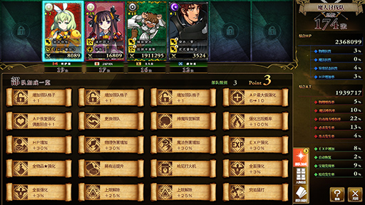

每凑齐３枚勋章，部队级别将提升１级。

部队级别与部队加成的可选项目数相等。

部队加成的增益效果极高且极为重要。
强烈建议积极收集勋章，以提升部队级别。

玩家可随时重新选择部队加成。

－－－－－－－－－－－－－－－－－－－－－－－－－－－－－－－－－－－－－－－－－

增加领队位置

初始领队位置仅有４个，最多可增加至７个。
即使只多１个位置，也将能够大幅提升部队战斗力。

ＡＰ最大值强化

将ＡＰ上限提高至１０。
ＡＰ上限为６点时，经常导致ＡＰ溢出造成浪费，如果有１０点则足以放心。
更高的上限可允许玩家攒下更多ＡＰ，发动更猛烈的连续攻击。

ＡＰ恢复强化

通常情况下，ＡＰ每轮将恢复２点，但选择此项后，在偶数回合可额外恢复１点。
多出的这１点价值非同小可。

更换领队

通常情况下，玩家需要在战斗持续多轮后才可更换角色。
 但选择此项后便可随时进行更换。
甚至可以在每轮都进行领队更换。

神魔阵营解禁

包含各魔人及神灵的团体——神魔在游戏初期默认不可使用，
在选择此项之后即可解锁。
强大的魔人和神灵，将会与你并肩作战。

强化出现概率

通常情况下，强化发动概率如下：

　・连续３轮没有行动的领队，将有５０％的几率得到强化
　・有利阵营的领队在每轮都有５０％几率获得强化

若选中此加成，则原有的５０％几率将变为１００％。

ＨＰ增加

物理伤害增加

魔法伤害增加

ＥＸＰ强化

以上加成均可增强部队能力。
效果极佳。

全物品★强化

所有物品的☆级别变为当前值的２倍。
　　例如
　　当前☆级别为４时，级别将变为８。

全面强化

所有部队状态值增加３%。

上限解除

部队状态值默认上限为４９％，
 若使用该加成，将使上限提高２５％。两项各加２５％，合计最高上限可达９９％。

稀有运提升

提升从宝箱中获取稀有卡片的几率。

哈尼打火机

战斗中ＨＰ归零时，可恢复５０％ＨＰ。
但一次任务中仅生效一次。

穷追猛打

战斗中敌方ＨＰ即使归０，我方仍可继续攻击。
这样做的好处在于可在战斗后获得相当高的
 过度杀戮数值，有助于宝箱的获取。

－－－－－－－－－－－－－－－－－－－－－－－－－－－－－－－－－－－－－－－－－

▲ 回到页首

■

### 资料：餐券与餐券环节

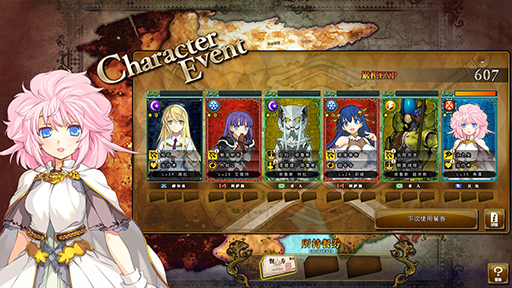

餐券最多仅可携带３张，超出部分无法继续获得。

当持有餐券时，将触发餐券环节。

进入餐券环节后，界面内将随机出现６人（从当前持有的角色中选出）。

对角色使用餐券，将进入该角色特有的小故事。
根据角色不同，每个角色可能拥有０－３段小故事。

因游戏机制，玩家将无法在一次游戏中阅览所有的角色小故事。（因为小故事数量众多）
 但从二周目起，当勾选「餐券小故事继承」后，餐券环节中将只出现玩家尚未阅览过小故事的角色，
 不再出现已阅角色。

设计本环节的初衷在于让玩家能够看到自己中意角色的小故事，
 但餐券环节中也包含了另一要素。

触发过餐券小故事的角色将获得相当于累计ＥＸＰ一半的额外ＥＸＰ。
因此对角色使用餐券可以迅速提升其☆级别。

何谓累计ＥＸＰ……

　　自开始游戏到当前为止，在战斗中所获得的ＥＸＰ的总和。
　　随着回合的推移，累计ＥＸＰ自然会越来越多。

　　因此，根据情况将餐券保留至后期的回合使用，
　　将可以得到更为大量的ＥＸＰ。

▲ 回到页首

■

### 资料：战果与各地区战况计算

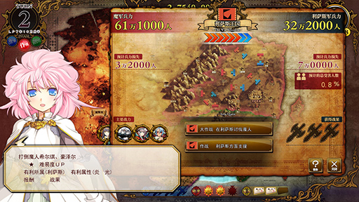

战果可为各地区战事带来重要影响。

每个地区最多拥有３个战果，超出无效。

在任务进行中或任务结束时都可获得战果。
 完成任务时，战果将自动被分配到任务所在的地区。

分配到各地区的战果，会在该回合结束时被清空。

简单地说：

　某地区战果为０　　说明该地区没有兰斯部队的支援，处于遭魔军猛烈压制状态
　某地区战果为１　　该地区得到了兰斯部队的支援，损失减半
　某地区战果为２　　该地区得到了兰斯部队的支援，损失大减
　某地区战果为３　　兰斯部队在该地区大战一场，对魔军造成了巨大损失

支援作战可带来１～２个战果。
全地区支援作战，能为４个地区各增加１个战果。
讨伐魔人作战可取得３个战果。
若中途放弃任务，放弃任务前取得的战果不会失去。

各地区状况的解读

|  | 解放状态。人类军已将魔军完全驱逐，夺回了该地区的安宁。 |
|---|---|
|  | 人类军处于优势。 |
|  | 战况处于拮抗状态。 |
|  | 魔军处于优势。 |
|  | 该地区已被占领，处于魔军统治之下。 |

　　魔军兵力　　　ｎｎｎｎ
　　人类兵力　　　ｎｎｎｎ

显示双方战力对比。
重点在于哪方兵力更多。

　　预计兵力损失　　　　ｎｎｎｎ
　　预计总受害人数　　　ｎｎｎｎ

预计兵力损失，指本回合中可能损失的兵力。
预计总受害人数，指本回合中可能损失的人口占该地区总人口数的百分比。
但该阶段数值仅为预估值。

根据兰斯等人进行的任务不同，与各地区发生的关联不同，
 数值将发生相应变化。

大规模作战准备中

务必留意，当魔军方出现此状态时，则说明该地区即将陷入危机。

当这一状态出现在人类方时，则说明人类军将可能在该地区取得胜利。

－－－－－－－－－－－－－－－－－－－－－－－－－－－－－－－－－

战果０的效果

　　　若魔军方兵力较多，战况将进一步恶化。

战果１的效果

　　　人类军损失减少５０％。
　　　魔军损失增加２万　（当敌军不少于１０万时）

战果２的效果

　　　人类军损失减少７０％。
　　　魔军损失增加４万　（当敌军不少于１０万时）

战果３的效果

　　　人类军损失减少９０％。
　　　魔军兵力减半　（当兰斯打倒魔人时）

人类死亡率

|  | ０．０％ |
|---|---|
|  | ０．２％ |
|  | ０．４％ |
|  | ０．８％ |
|  | １．５％以上 随着回合推进，死亡率将进一步累加 |

　　　　自第６回合起 ＋０．２
　　　　人类军２０万以下 ＋０．２
　　　　人类军１０万以下 ＋０．２
　　　　自第９回合起、若仍未打倒任何魔人 ＋０．4

但只要有１个战果便可使损失减半。

魔军占领的条件

　　・魔军兵力多于人类军
　　・战况方面魔军占据优势
　　・人类军兵力不大于５万（若有战果时，即使少于２万也能坚持住）

战果１个　人类军损失减少５０％，人口损失减少＋，魔军损失增加＋
 战果２个　人类军损失减少７０％，人口损失减少＋＋，魔军损失增加＋＋
 战果３个　人类军损失减少８０％，人口损失减少＋＋＋，魔军损失增加＋＋＋

拥有１个战果与否可使损失出现成倍差异。因此战果非常重要。

▲ 回到页首

■

---

## 指南 09 任务

> 源文件：`09.html`

### 9．任务

此次旅程将以一个个任务为单位进行划分。

任务以类似于流程图的方式展现。
　※图中的节点与节点之间体现事件的先后关系，并不代表它们为位置相连的地图。

扁箱状节点表示＜接下来发生的事＞。
＜接下来发生的事＞
 既可发生在几步之后、几分之后、几日之后，也可发生在前进数米之后。
许许多多＜接下来发生的事＞相连接，即构成了一则庞大的故事——任务。

在＜接下来发生的事＞中，将出现种类各异的事件。
有些是触发战斗，有些是捡到好东西，也有些是可以让部队恢复的地点。

其中也有完全没有事件发生的节点。

[要点]

有利团体

任务中进入战斗时，
 若领队属于有利团体，则其得到强化的几率将提升。
使用这些有利团体的角色，就能在战斗中占据优势。

有利属性

当前的任务中，该属性很有可能是敌方的弱点属性。
使用带有这些属性的角色，就能在战斗中占据优势。

难易度

用于表示敌人的强大程度。尽管仅有1位数字，
 但难易度每变化１点，敌人的强度都将发生剧变。
随着故事进行，难易度数值将越来越高。
若难易度与回合数相同，则可认为玩家的攻略情况较为符合预期。
若难易度大于回合数，则表示玩家进入了一条较难攻略的路线。

ＨＰ

兰斯所率部队的ＨＰ值。建议时刻注意ＨＰ的残余量，
一旦归零便将全军覆没。

可以打开[ROUTE]界面，
 事先查看恢复点的位置。

　　战果　　将影响该地区的战况
　　勋章　　集齐３枚可获得部队加成
　　餐券　　可用于在餐券环节中阅览人物小故事

以上三项最多均可拥有３个，是贯穿本游戏始终的重要物品。

|  | 恢复所有ＨＰ，并恢复技能可用次数等。即便面前是刀山火海，只要到了这里，就能小憩片刻。 |
|---|---|
|  | 出战角色的☆级别提升１。级别已经很高，难以再提升☆级别的角色也可通过此图标 直接升级，好好利用将会很顺心。 |
|  | 物品的☆级别原则上只能 通过此图标得到提升。所有物品的☆级别都将通过该图标同时提升， 因此持有物品越多，收效越显著。 |
|  | 走上此图标将发生战斗。 头目与强敌的标识与其本体的外形相似，容易辨别， 挑战前记得先进行存档。 |

▲ 回到页首

■

### 资料：无法战胜敌人，卡关时

根据选择的任务或路线不同，
 玩家可能遇到当前战力偏低造成无法取胜，或战斗极度艰难的情况。

此时可尝试用下列方法解决。

１．放弃当前路线，读取（ＬＯＡＤ）此前的存档
　　重新选择其他任务、或其他选项等。

２．如遇到无法取胜的战斗，可在战斗开始前确认是否必须获胜才可继续前进
　　游戏中有许多战斗可在平手或失败后继续游戏。

３．如果打不过，可以转而选择轻松的任务
　　若某个地区因此而陷入危机，也是无可奈何的事。
　　若让兰斯每一回合都前去打倒魔人，玩家的负担将会很重。

４．从ＭＥＮＵ中选择「放弃任务」
　　该任务将不计为已完成任务，但此前在该任务中获得的EXP、
　　宝物等成果都将保留。
　　某些任务的奖励丰厚，有时或许也可以故意中途放弃，
　　通过反复进行同一任务赚取奖励。

▲ 回到页首

■

---

## 指南 10 战斗

> 源文件：`10.html`

### 10．战斗

本作中的战斗形式为团体战。

最初队伍中只有兰斯和希露两人，
 但随着游戏进行，伙伴将逐渐增多，继而形成好几十人的团队。

▲ 回到页首

■

### 10-1．战斗

玩家可在部队编制中选择领队出战。
 但与通常的ＲＰＧ游戏不同，这并不意味着领队之外的角色都在后方待机。

领队只是战斗时的核心角色，未被选择出战的角色也将一同参加战斗。
　※　同一团体所有角色的战斗力，都会计入领队的战斗力中

同时，敌方也不是单枪匹马，基本都是抱团作战。

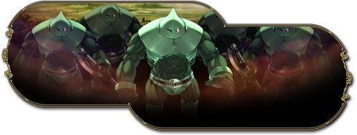

画面中仅显示５名敌人，但并不代表敌人只有５名。
这类显示仅表示对方为团体作战。

这类集团表示规模较小的队伍。
可以认为这是一支２０人左右的部队。

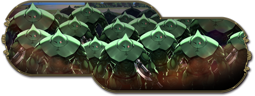

这类数量较多的敌方则为中等规模的敌军部队。
基本为５０－２００名左右，
属于最常见的敌军部队。

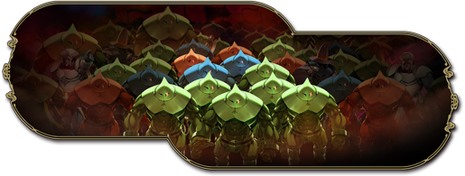

数不胜数的大军。
兵力可多达几千、几万。

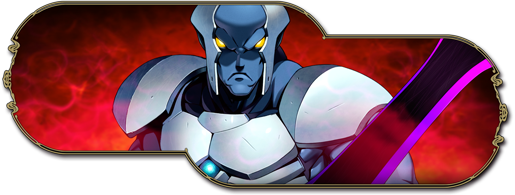

有的敌人则是独自出战。
兰斯等人以多欺少或许有些卑鄙，
 但面对强大的敌人，也无需顾虑这些。

不同战斗结果的路线各异

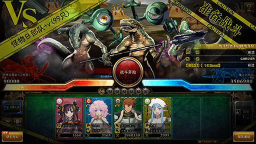

有时界面上会出现重要提示，需注意查看。

　　败北＝前进

出现该提示时，即便败北，故事仍将继续。并不会造成游戏失败。

　　超过时间＝前进

出现该提示时，若未在限制轮数内分出胜负，战斗将强制结束。

兰斯１０中将有许多上述提到的「战败剧情」。
 但若通过努力战胜对手，也可进入特殊的胜利路线。
初次挑战时可能会感到部分敌人难以战胜，但也可在不断变强以后打败他们。

部队编制

每次战斗开始前可以进行部队编制。
玩家可根据敌人的外观、名称等信息，适当变更队伍配置。

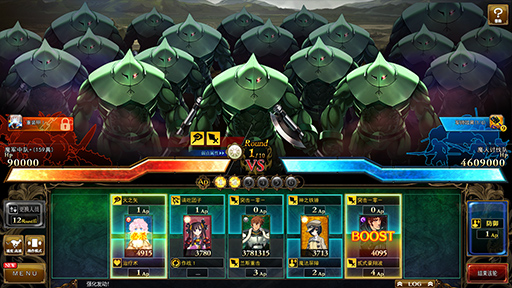

１．每轮开始

　　　敌人要采取的行动将在每轮开始时确定并显示。
　　　此时有一定几率显示敌方弱点（概率５０％）。

２．己方行动．准备阶段

　　　ＡＰ恢复２点。

　　　部分出战角色可能获得「强化」，「连击」，「必杀」
　　　等状态，仅持续一轮。

　　　发动抢攻或自动攻击的角色将在该阶段行动。

３．己方行动．玩家选择阶段

　　　选择要使用的角色技能。
　　　发动技能将消耗ＡＰ（ＡＰ点数不足时技能无法使用）。

防御

　　　可消耗１点ＡＰ来部署「防御」的支援状态。
　　　防御可更好地帮助玩家抵挡敌方在该轮发起的攻击。

　　　同时，「防御」可以叠加４次。

　　　当可用ＡＰ归零，且没有零ＡＰ技能可用时，
　　　将会进入敌方的回合。
　　　在ＡＰ还有剩余的时候，也可以直接点击「结束该轮」，将ＡＰ保留。

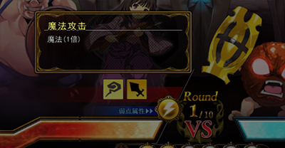

　　　点击表示敌方行动的标记，即可得知对方的下一步动作。
　　　可以以此为据来思考对策。

　　　点击敌方或我方的支援效果，可以查看支援状态具体内容。
　　　当敌方或我方进入异常状态时，也可点击相应图标查看异常状态描述。

４．敌方展开行动

　　　敌方将按照显示的行动标记采取行动。

５．当前轮结束

　　　若本次战斗有轮数限制，则战斗将在最后一轮结束后告终。

战斗结束

战斗结束后，将显示战斗成果结算界面。

　　若战斗结果为「胜利」或「平局」
　　　　根据战斗结果不同，将获得相应的ＥＸＰ。

　　若战斗结果为「胜利」
　　　　将有一定几率获得宝箱。

▲ 回到页首

■

### 资料：异常状态

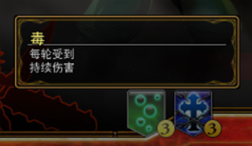

战斗时，异常状态将显示于敌我双方的ＨＰ指示条上方。
任何异常状态都将带来降低能力的减益。

此类状态可通过特定技能进行施加。

　　例
　　技能「请吃团子」除攻击效果外，还附加有「▼毒 100%」效果。
　　当此技能命中对方时，将有１００％的几率为对方施加「毒」这一异常状态。

　　但如果对方持有「异常状态抗性」，则最终施加成功几率为减去抗性数值后的值。
　　敌方的异常状态抗性通常不可见。
　　但玩家可以通过「解析」等技能一窥究竟。

异常状态最多只可同时存在３个。

异常的持续时间是固定的，经过一段时间后将自动解除。

也可通过「状态恢复」等技能消除异常状态。
若角色陷入棘手的异常状态，可以想办法将异常解除。

　　例
　　希露等人持有的「治疗术」技能不仅能恢复ＨＰ，同时也能能消除异常状态，非常方便。

|  | 混乱 随机使一名角色陷入眩晕状态。 若敌方处于混乱状态，则随机阻止敌方的１次行动。 |
|---|---|
|  | 虚弱 攻击时降低２０％攻击力。 防御时增加２０％所受伤害。 |
|  | 毒 每轮损失ＨＰ，损失量为当前ＨＰ的５％（ＨＰ最低剩余１）。 如有「毒效果ＵＰ」生效，则ＨＰ损失量增至１０％。 |
|  | 诅咒 诅咒状态持续时不会带来任何效果， 但在诅咒消失时，将失去相当于当前值２０％的ＨＰ（ＨＰ最低剩余１）。 同时，如果在同一场战斗中反复受到诅咒，则诅咒的倒计时轮数将增加。 |
|  | 黑暗 命中率下降２５%。 |
|  | 反再生 令恢复类效果全部失效（含自动恢复） |
|  | 沉睡 回避率变为０。 受到攻击时的伤害翻倍。 但该状态将在遭受一次攻击后立刻解除。 |
|  | 燃烧 炎属性伤害增加１００％。 |
|  | 冰冻 冰属性伤害增加１００％。 |
|  | 触电 雷属性伤害增加１００％。 |
|  | 致命伤 只出现在敌方身上。 攻击时降低５０％攻击力。 |
|  | 即死预告 ３轮后死亡。 |
|  | 恐怖 ＡＰ恢复量－１。 |

▲ 回到页首

■

### 资料：支援状态

战斗时显示在右侧或左侧。右为我方，左为敌方。
支援状态大都是对战斗有利的增益状态。

最多可同时存在７个支援状态。

有些支援状态会在战斗一开始就存在，如地形效果。
但大多数支援状态均通过技能产生。

也可通过「侧面排除」等技能消除支援状态。

存续时间

　　・存在时间受限，在数轮后自动消失
　　・永久存在
　　・可通过「侧面排除」等技能消除
　　・无法用「侧面排除」等技能消除

　　　——支援状态分为上述几种不同类型。

主要的支援类型

援军类

即前来一同作战的部队。
通常为大量援军、辅助武器、宠物等。

地形类

寨、沙袋、屋内　等防御设施。

　　雾　…　１轮最多行动２次。

——以上均属于特殊类型的支援状态。

各种攻击支援、防御支援

在战斗时提升攻击或防御力的支援状态。

　　分为「军师效果(1/6)」 由军师策略带来增益
　　「蓄力(1/3)」 等带来攻击力ＵＰ效果
　　「魔法屏障」等可以抵挡攻击的魔法
　　等

※　战斗中只将效果最强的状态计入增益，不会累加。

其他特殊支援状态

无敌结界

魔人拥有令所有普通攻击无效化的能力。
兰斯所持的卡奥斯，是唯一能够破坏无敌结界的武器。

在与魔人交战时，需要先让兰斯攻击，
 破坏无敌结界。

▲ 回到页首

■

### 资料：其他相关因素

攻击

指近距离物理攻击，如用普通的剑攻击或击打对手。
这种攻击方式最为常见，种类也最多。
受「物理增伤率」、「物理抗性」等效果影响。

　　优点　　便于使用，ＡＰ消耗低

　　缺点　　有时无法命中拥有「回避率」的敌人
　　　　　　无法攻击「飞行状态」下的敌人

攻击(远程)

使用弓箭或发射物等进行远距离攻击的手段。
受「物理增伤率」、「物理抗性」等效果影响。

　　优点　　命中率高
　　　　　　可攻击「飞行状态」下的敌人

　　缺点　　在迷宫等拥有「屋内」支援状态的地点时，攻击力将减半

魔法

使用魔法进行攻击。
受「魔法增伤率」、「魔法抗性」等效果影响。

　　优点　　威力较大
　　　　　　百发百中

　　缺点　　ＡＰ消耗较高
　　　　　　有「哈尼」等敌人对魔法免疫

视敌人不同，战斗时需要合理配置队伍。

如敌方物理抗性较高时，可使用法师为主力。
 在迷宫内作战时，可将远程攻击角色换下。

在领队选择上，尽量活用部队状态较高者、或「物理增伤率、魔法增伤率」较高者
 ——等等。

ＡＰ策略

技能在使用后，下一轮发动该技能所需的ＡＰ会增加１点。
若连续发动同一技能，将造成导致每次发动均多付出１点ＡＰ，不太划算。
要想高效地使用技能，可以隔一轮发动一次，避免连续使用。

ＡＰ累积及限用１次的技能在使用上受到较大限制。
 但此类技能可通过任务中的「恢复标识」处重置可用次数，因此建议玩家
在确认恢复标识位置后，有计划地使用此类技能。

防御按钮

消耗１点ＡＰ，发动「防御」支援状态。

　　发动１次获得３０％抗性
　　发动２次获得５０％抗性
　　发动３次获得７０％抗性
　　发动４次获得９０％抗性

叠加３至４次防御后，基本可以抵挡敌方的任何强力攻击。

※　由于「防御」也属于支援状态，所以若当前已存在７个状态，则「防御」发动无效。

ＣＯＭＢＯ

战斗中各轮内的每次攻击都会使ＣＯＭＢＯ值＋１。

ＣＯＭＢＯ每加１点，将提高１０％的伤害（ＣＯＭＢＯ５将增加５０％的伤害）。

在进行多次攻击时，可以先让低攻击力角色进行攻击，堆叠ＣＯＭＢＯ，
之后再使用高攻击力角色。由此可以增加伤害。

也可以采用先攒下足够ＡＰ后再一口气进行连续攻击，堆叠ＣＯＭＢＯ数的战术。

附加效果

获得「强化」状态的角色攻击力将增至１.５倍。

「弱点属性」　使用敌方弱点属性技能进行攻击，可额外造成１００％伤害。

「特定对象」　使用针对特定对象有伤害加成的技能，在攻击该对象时可额外造成１００％伤害。

　　例　标注有「对哈尼 效果大」的技能在击中哈尼时可使伤害翻倍。
　　　　针对「异常」状态敌人进行的攻击。

　　例　使用「炎」属性技能攻击处于异常状态「燃烧」的敌人，将额外造成１００％伤害。

拥有「必杀」状态的角色攻击时将额外造成１００％伤害。

拥有「连击」状态的角色攻击时将进行两次攻击。

更换领队

玩家可在战斗持续一定时间后更换领队。
可在界面左侧看到多少轮后可以进行更换的提示（显示为「ｎＲｏｕｎｄ后」）。

换上场的领队，在该轮默认为行动结束。
倘若在更换人员前使用了技能，则本轮将不能再进行更换操作。

同时如果一直不更换人员，则更换领队功能
 将一直保持在可用状态。

捕获怪物

当持有「魔物猎人」技能的角色参战时，有时将捕获到怪物。

弱点属性的显现

敌方在战斗中的每一轮内都可能暴露弱点属性。
使用与敌方弱点属性相同属性的技能进行攻击，可额外造成１００％伤害。

每轮有５０％左右几率出现弱点属性。
当该轮结束，弱点属性也将消失。

若领队角色拥有「弱点发现」技能，则敌方的弱点将始终显示。
但部分没有弱点的敌人将不显示弱点属性。

强化的触发

得到强化状态的角色在进行攻击时其攻击力将增加至１.５倍。
其恢复能力也将增至１.５倍。

连续３轮没有行动的角色将有５０％的几率获得强化。
属于有利阵营的领队将有５０％的概率获得强化。
属于有利阵营的领队在首轮战斗中得到强化的概率为１００％。

连击的触发

连击拥有两种触发方式。
　・角色偶然获得「连击」状态
　・角色技能附带连击效果

当以上两种情况同时存在于同一个角色上时，以技能的连击效果为准。

必杀的触发

必杀可使角色攻击伤害增加１００％，但如果角色攻击时同时拥有连击状态，
则仅第一击附带必杀效果。

ＤＯＷＮ

敌方攻击造成角色ＤＯＷＮ（无法战斗）时的状态。

如果同一团体内还有其他角色，则其他角色将跳出代为参战。
将优先跳出★级别高的角色。
如果没有可代为出战的角色，则该角色的ＤＯＷＮ状态将持续。

从[ＭＥＮＵ]中　重新开始战斗

当选错先后顺序、失败、或者想要重开战斗时，
 玩家无需在ＬＯＡＤ中重新读取，可直接从ＭＥＮＵ中选择「重新战斗」。

头目战

魔人等部分强敌将以头目身份登场。
分辨方法：战斗开始界面的文字框呈红色　（通常战斗为黄色）

头目战胜利后１００％获得宝箱。
部分头目设有单次承受伤害上限。
即死类技能对头目无效。

▲ 回到页首

■

### 资料：战斗成果（变强的方法）

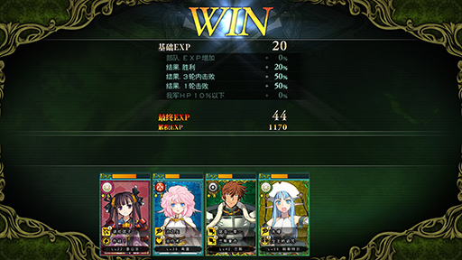

获得更高ＥＸＰ的方法

部队.ＥＸＰ增加　＋ｎｎ％

　　　按照部队状态中「ＥＸＰ增加」项目的百分比增加。

结果.胜利　＋２０％

　　　战斗胜利即可增加ＥＸＰ获得量。

结果.３轮内击败　＋５０％

　　　快速击败敌方可获得额外奖励。

结果.１轮击败　＋５０％

　　　指在某一轮中击杀ＨＰ１００％的敌方。
　　　无需在首轮击败敌人。
　　　可以先积累ＡＰ，在足以输出巨量伤害后尝试挑战。
　　　无论第４轮还是第１０轮都可以进行挑战，
　　　当然，在首轮完成击杀也是可以的。

我军ＨＰ１０％以下　＋５０％

　　　在极限状态下击败敌方，会得到额外奖励。
　　　故意走钢丝并非不可行，但稍有不慎则可能失败。

高效获得宝箱的方法

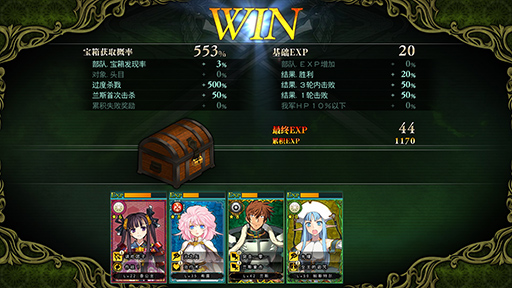

部队.宝箱发现率　＋ｎｎ

　　　发现率将按照部队状态中「宝箱发现率」项目的百分比增加。

对象.头目　＋１００％

　　　当敌方为头目时，１００％掉落宝箱。
　　　此时不需要想方设法提高掉落率。

过度杀戮　＋ｎｎ

　　　溢出的伤害越多，宝箱的额外获得率就越高。
　　　战斗将在敌方ＨＰ归零时结束。
　　　因此需在敌人ＨＰ尽可能低的时候，用火力最强的技能来溢出伤害。

　　　在部队加成中选择「穷追猛打」后，即使敌方ＨＰ归零，
　　　也能任意继续攻击，此时便能更轻松地达成「过度杀戮」。

ｎｎｎ 首杀　＋５０％

　　　若战斗中将敌方ＨＰ削减至０的角色
　　　是在此任务中首次击杀敌人，则可获得这一仅限一次的奖励。
　　　５０%带来的收益不小，可以每次都使用不同角色进行最后一击。

累积失败奖励　＋ｎｎ

　　　连连与宝箱失之交臂时，将获得该项奖励。
　　　运气再差，迟早也能有回报。

宝箱内容

敌方规模为少数时，宝箱内将出现２张卡片，普通规模时出现３张卡片。

　　角色.普尔贝特 技能.「宝物鉴定师」
　　部队加成.「稀有运提升」
　　物品.「小小里程碑Ｂ」
　　成就.「小小里程碑Ｅ」

此类角色技能、物品、成就，都可提高稀有卡片的出现概率。
它们可以叠加生效，如果全部集齐，效果也将非常可观。

▲ 回到页首

■

### 资料：战斗计算公式

该部分内容介绍游戏内部计算公式，在游戏时无需刻意理解。
 想要深入了解的玩家可用于参考……
（……不过这些计算式比较笼统，计算值和实际值之间可能会有少许误差）

当使用技能：兰斯重击［攻击(3倍)　必中］时

●　回避计算

命中率＝１００％（初始值）

　　－ｎｎ％　　敌方拥有回避率时
　　－２５％　　附有异常状态「黑暗」时
　　＋２５％　　技能附带「远程」效果时
　　＋２０％　　领队中有角色拥有技能「命中率」时
　　＋命中　　　技能附有「必中」效果时

通过以上加减计算可判断出实际命中率。

●　基础伤害计算

伤害１　＝　领队ＡＴ　＊　技能倍率

　　　以兰斯重击为例，此时技能倍率为３倍

伤害２　＝　伤害１　＊　（１００％＋部队状态中的增伤率）

　　　物理攻击造成伤害时　计算「物理增伤率」
　　　魔法攻击造成伤害时　计算「魔法增伤率」

伤害３　＝　伤害２　＊　（１００％＋各种支援效果的增伤率）

　　　战斗中有多个同类支援效果生效时，仅计入数值最大者

例如角色.卡绯拥有的技能「领队配置效果 物理增伤率 +20%」

　　　若场上同时存在支援状态.毘沙门天（「物理增伤率 +40%」）
　　　则只计算＋４０％这个值

基本伤害　＝　伤害３　＊　（１００％＋另几种加成）

　　　强化　　　　　　　　＋５０％
　　　处于「虚弱」状态　　－２０％
　　　处于「致命伤」状态　－５０％
　　　军师效果　　　　　　＋１０％＊军师作战等级

●浮动数值计算

　　　游戏将对上述得出的基本伤害进行　＋－２０％　的随机伤害修正（数值浮动）

●抗性计算

伤害５　＝　基本伤害　＊　（１００％－敌方部队状态中的抗性）

　　　物理攻击造成伤害时　计算「物理抗性」
　　　魔法攻击造成伤害时　计算「魔法抗性」

　　　敌方的抗性数值为隐藏属性。

最终伤害　＝　伤害５　＊　（１００％－敌方各种支援状态影响下的抗性倍率）

　　　战斗中有多个同类支援效果生效时，仅计入数值最大者。

　　　例如支援.「重装甲２」的「物理抗性 +20%」效果
　　　以及支援.「寨」的「物理抗性 +20%」效果

　　　两者同时存在时，将仍然只可得到２０％加成效果。

此数值即为最终伤害。

●各类额外伤害累计

若最终伤害为１００点

触发「必杀」时

　　伤害＋１００点　（ＨＰ削减合计　２００点）

使用敌方弱点属性攻击时

　　伤害＋１００点　（ＨＰ削减合计　３００点）

使用对特定对象增伤的技能时

　　伤害＋１００点　（ＨＰ削减合计　４００点）

ＣＯＭＢＯ达到１０点时

　　伤害＋１００点　（ＨＰ削减合计　５００点）

攻击处于异常状态的敌人时

　　使用火属性技能攻击处于「燃烧」状态的敌人时
　　伤害＋１００点　（ＨＰ削减合计　６００点）

　　攻击处于「虚弱」状态的敌人时
　　伤害＋２０点　（ＨＰ削减合计　６２０点）

　　攻击处于「睡眠」状态的敌人时
　　伤害＋１００点　（ＨＰ削减合计　７２０点）

当然，在单次攻击中几乎不可能同时累加如上述这么多的增益，
 但只要做好规划，就有机会释放出威力巨大的攻击。

▲ 回到页首

■

### 10-2．自动战斗

从第２回合开始出现。
此类战斗将发生于任务中的「道路」上。
 战斗时为半自动操作，兰斯不参与指挥。

战斗开始前

出战领队将全部随机分配。
玩家无法进行编制操作，上阵的几名领队有可能出自同一团体。

可通过[仅限一次重新分配]，来重置出战人员。

点击[自动战斗开始]后即可进入自动战斗。

何时重新分配

重新分配的目的在于让ＡＴ更高的队伍上阵。
综合ＡＴ即我方的攻击力，因此其数值自然越高越好。
根据上阵组合的不同，有时也会出现较低的数值。

希望自己想要培养的角色能够出战时

自动战斗也能得到ＥＸＰ，提升人物的☆级别。

希望得到额外加成时

　　同一属性　四张卡　　伤害减半　经验值２倍

　　同一阵营　四张卡　　伤害减半　经验值２倍

　　同一属性　五张卡　　伤害无效　经验值３倍

　　同一阵营　五张卡　　伤害无效　经验值３倍

　　可通过重新分配来获得以上额外加成。

希望使用持有特定技能的角色时

　　[自动战斗效果]　　　伤害减半　经验值２倍

　　[自动战斗效果改]　　伤害减半　经验值３倍

　　[魔物猎人]　　　　←可在战斗后捕获到怪物

▲ 回到页首

■

---

## 指南 11 挑战模式与联合部队

> 源文件：`11.html`

### 11．挑战模式与联合部队

注意：

　　本模式入口将出现在游戏启动界面。玩家需要先「通关」一次才能解锁。

▲ 回到页首

■

### 11-1.挑战模式

在本模式中，玩家可以使用自己培养的联合部队，
尝试挑战强大的敌人。

专属规则

战斗中使用过的角色不能用于之后的战斗中。
这是为限制玩家只使用部分强力角色而设的规则。

在挑战模式中，玩家无法得到ＥＸＰ和宝箱。
也就是无法培养部队强度。

通过完成任务，玩家可以获得能够永久强化部队能力的成就。

▲ 回到页首

■

### 11-2.联合部队

联合部队为游戏通关后，集合各角色最强数据组成的部队。
部队数据只有在「通关后」，「ED字幕」播放完毕后才会更新。

角色、物品

此前游戏中获取的所有角色及物品都将进入联合部队。
★级别・重复数只取过去最高数值。

补充

部分角色不会加入联合部队。

　　・某霍尔蒙克斯（由于可能显著破坏游戏平衡）。
　　・在同一角色过多时，将只保留部分具有代表性的卡片。

▲ 回到页首

■

---

## 指南 12 探险小窍门

> 源文件：`12.html`

### 12．探险小窍门

这里会介绍一些可以帮助玩家享受『兰斯１０』乐趣的“小窍门”。

■

注意积累ＡＰ

积累ＡＰ再一口气用掉更易于造成较大伤害。
有时候选择忍耐也很重要。

▲ 回到页首

■

同样效果的技能不会重叠

同时持有物理抗性+30％和物理抗性+20％两种技能时，
 只有效果较大的一方（+30％）生效。（参考：资料　战斗计算公式）
 因此，同样效果的技能可能只需一个就够了。
但有的敌人会清除支援状态，
 所以玩家可借由使用多个支援技能，来避免失去支援状态。

※标注为‘部队编制效果’的技能效果可以重叠。
　此类技能只需编入部队即可生效，
　玩家可以轻松查看。（参考：资料　部队状态）

▲ 回到页首

■

注意凑齐各类属性

每一关卡都将设有有利属性。
有利属性将会是敌人的「弱点属性」。请注意查看敌人的状态。
同时，当敌人处于燃烧、触电、冰冻等异常状态时，也有机会使用相应属性攻击造成巨大伤害。
就这一点而言，任务中凑齐各类属性也是颇有意义的。

▲ 回到页首

■

培育各种角色

每个角色都可能有派上用场的一天。
如果有余力，建议多培养一些不同的角色。

如果觉得「我就只会用这个角色！」，
那么也请坚持想法。

▲ 回到页首

■

积蓄ＣＰ是完美通关的捷径

每达成一个成就都会使得ＣＰ增加１点，若多次
 重复通关同一路线，将不能提升ＣＰ总数。
请以达成各种不同结局为目标。

▲ 回到页首

■

---

## 参考 01 基本操作

> 源文件：`r01.html`

■参考手册

### 01．基本操作

除鼠标以外，玩家还可通过触屏操作「兰斯１０」。

出现对话框时，玩家可使用鼠标或键盘进行如下操作。

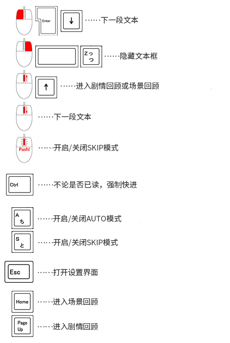

■

---

## 参考 02 启动界面

> 源文件：`r02.html`

■参考手册

### 2．启动界面

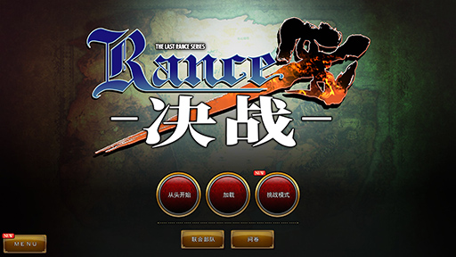

| [从头开始] | 从头开始游戏 |
|---|---|
| [ＬＯＡＤ] | 打开ＬＯＡＤ界面 ⇒ [ＬＯＡＤ] |
| [挑战模式] | ※初始状态下不会显示该模式。需在达成某个条件后才可解锁 |
| [问卷] | 玩家可以通过此按钮发送游戏感想等讯息到敝公司 发送时需处于能够连接互联网的环境下 期待您的来信 |
| [ＭＥＮＵ] | 显示ＭＥＮＵ ⇒ [ＭＥＮＵ] |

■

---

## 参考 03 ＭＥＮＵ

> 源文件：`r03.html`

■参考手册

### 3．ＭＥＮＵ

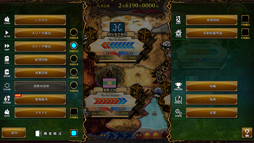

| [ＬＯＡＤ] | 可以读取保存过的数据 ⇒ [ＬＯＡＤ界面] |
|---|---|
| [ＡＵＴＯ模式] | 在阅读剧情时自动播放文本 |
| [ＳＫＩＰ模式] | 在阅读剧情时高速跳过文本 |
| [剧情回顾] | 回顾一定量的对话 |
| [场景回顾] | 倒回至一定量之前的剧情场景 |
| [消除对话框] | 消除对话框若开启快捷按钮，该按钮将在剧情界面中显示 |
| [更换秘书] | 更改担任秘书的角色 |
| [关闭游戏] | 关闭「兰斯１０」 |
| [回到标题界面] | 回到游戏启动时的界面 ⇒ [启动界面] |
| [收藏] | 可以查看收藏 ⇒ [收藏] |
| [指南] | 打开您当前正在阅读的指南另可从开始菜单或窗口菜单点击 「帮助(H)」→「游戏指南(M)」 来打开本指南 |
| [设置] | 打开调整游戏内各项设置的界面 ⇒ [设置] |
| [帮助] | 显示各个功能的相关说明 |
| [返回] | 回到原来的界面 |

■

---

## 参考 04 收藏界面

> 源文件：`r04.html`

■参考手册

### 4．收藏界面

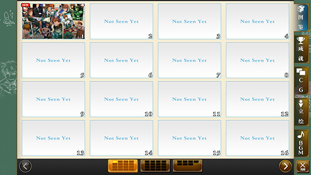

| [图鉴] | 可查看在游戏中看过的图鉴 |
|---|---|
| [成就] | 可查看游戏通关等成就 |
| [ＣＧ] | 可查看游戏中看过的剧情ＣＧ或场景 |
| [ＢＧＭ] | 可欣赏游戏中出现过的ＢＧＭ |
| [１]-[４] | 切换页面 |
| [图像一览标志] | 切换页面 也可通过上下滚动鼠标滚轮操作 |
| [关闭] | 回到原来的界面 |

■

---

## 参考 05 ＬＯＡＤ界面

> 源文件：`r05.html`

■参考手册

### 5．ＬＯＡＤ界面

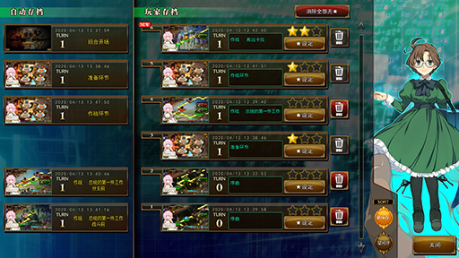

| [自动存档] | [回合开场] [准备环节] [作战环节] [据点环节] [任务 分支前] [任务 战斗前] 可读取玩家最后一次到达以上进度时的数据 |
|---|---|
| [玩家存档] | 可读取玩家手动ＳＡＶＥ时储存的数据 |
| [★设定] | 玩家可自行为存档标注最多三个★符号 ★设定并没有任何特定规则，请任意进行标注 |
| [删除] | 删除指定ＳＡＶＥ数据 |
| [删除全部无★] | 删除所有未标注★的ＳＡＶＥ数据 |

■

---

## 参考 06 事件・剧情界面

> 源文件：`r06.html`

■参考手册

### 6．剧情・事件界面

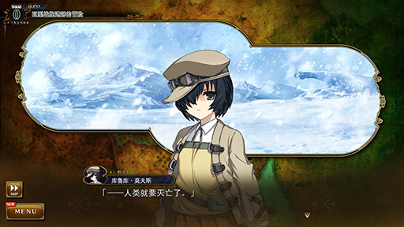

可点击右键关闭对话框。

| [ＭＥＮＵ] | 显示ＭＥＮＵ ⇒ [ＭＥＮＵ] |
|---|---|

■

---

## 参考 07 回合开场界面

> 源文件：`r07.html`

■参考手册

### 7．回合开场界面

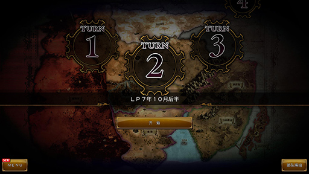

| [开始] | 开始回合 |
|---|---|
| [部队编制] | 显示部队编制界面 ⇒ [部队编制界面] |
| [ＭＥＮＵ] | 显示ＭＥＮＵ ⇒ [ＭＥＮＵ] |

■

---

## 参考 08 准备作战界面

> 源文件：`r08.html`

■参考手册

### 8．准备作战界面

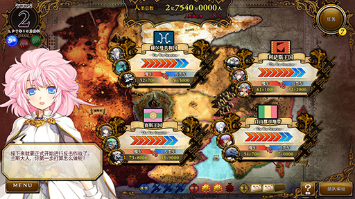

| [利萨斯王国] [赫尔曼共和国] [赛斯王国] [自由都市地区] | 转移至地区选择界面并列出该地区的可选择任务 ⇒ [任务界面] |
|---|---|
| [任务] | 显示所有地区的任务 ⇒ [任务界面] |
| [帮助] | 显示帮助信息 |
| [部队编制] | 显示部队编制界面 ⇒ [部队编制界面] |
| [ＭＥＮＵ] | 显示ＭＥＮＵ ⇒ [ＭＥＮＵ] |

■

---

## 参考 09 任务界面

> 源文件：`r09.html`

■参考手册

### 9．任务界面

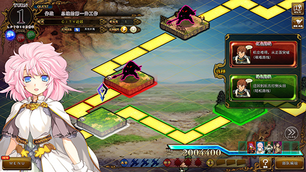

| [选项] | 任务中可能出现前、右、左最多三种选项 部分选项在没有满足条件时无法选择 |
|---|---|
| [ROUTE] | 展开任务地图 |
| [速度：ｘｘ] | 每次点击都将改变任务中的动画速度 |
| [查看路线] | 将光标重叠可使选项隐藏，以查看被遮挡的部分路线 |
| [帮助] | 显示帮助信息 |
| [部队编制] | 显示部队编制界面 ⇒ [部队编制界面] |
| [ＭＥＮＵ] | 显示ＭＥＮＵ。 ⇒ [ＭＥＮＵ] |

■

---

## 参考 10 部队编制界面

> 源文件：`r10.html`

■参考手册

### 10．部队编制界面

选择角色卡，点击即可替换领队。
也可通过拖动来改变卡片位置。

| [团体标签] | 点击可切换团体 |
|---|---|
| [获取顺序] [名称顺序] [ＡＴＫ顺序] [★顺序] | 按条件更改显示顺序 |
| [详情] | 每次点击都将切换卡片显示信息 |
| [部队加成] | 显示部队加成界面 ⇒ [部队加成界面] |
| [角色信息] | 显示角色信息界面 ⇒ [角色信息界面] |
| [帮助] | 显示帮助信息 |
| [关闭] | 回到原来的界面 |

▲ 回到页首

■

### 10-2．部队加成界面

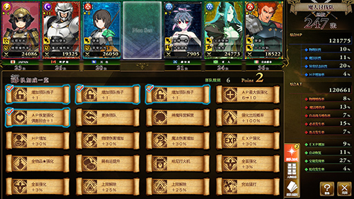

| [部队加成] | 部队加长共有２０个，点击按钮即可激活可随时进行重选 |
|---|---|
| [角色信息] | 显示角色信息界面 ⇒ [角色信息界面] |
| [部队编制] | 显示部队编制界面 ⇒ [部队编制界面] |
| [帮助] | 显示帮助信息 |
| [关闭] | 返回原来的界面 |

▲ 回到页首

■

### 10-3．角色信息界面

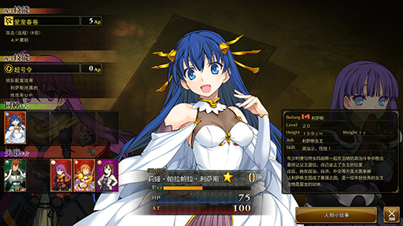

| [同一卡片] | 点击后将切换显示所选卡片信息 |
|---|---|
| [关联卡片] | 显示与当前角色关系密切的角色卡片点击后将切换显示所选卡片信息 |
| [人物小故事] | 可再次阅览已观看过的角色特有小故事 |
| [关闭] | 返回原来的界面 |

■

---

## 参考 11 战斗开始界面

> 源文件：`r11.html`

■参考手册

### 11．战斗开始界面

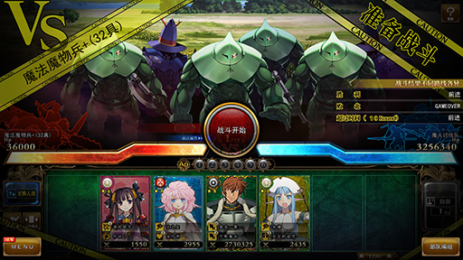

| [战斗开始] | 开始战斗 |
|---|---|
| [部队编制] | 在战斗开始前，可进行部队编制 ⇒ [部队编制界面] |
| [ＭＥＮＵ] | 显示ＭＥＮＵ ⇒ [ＭＥＮＵ] |

■

---

## 参考 12 战斗界面

> 源文件：`r12.html`

■参考手册

### 12．战斗界面

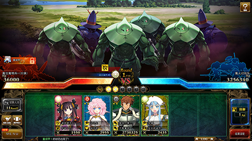

| [更换人员] | 可更换领队（无法更换时不能点击） |
|---|---|
| [速度：＊＊] | 每次点击都将改变战斗时的动画速度 |
| [操作模式] | 在２种不同的操作模式间进行切换 操作模式１（两次点击模式） 角色卡将被放大展示 点选角色后，将显示可供选择的技能列表 随后选择技能释放 操作模式２（单次点击模式） 角色卡将被缩小展示， ２个技能可供直接点选 点选后立刻释放 |
| [防御] | 使用１ＡＰ采取防御行动 |
| [结束该轮] | 结束我方的行动并进入敌方行动时间 我方无法进行任何行动的情况下将自动交替至敌方行动 而在我方仍可采取行动时也可以手动选择结束该轮 |
| [敌方行动标记] [支援标记] [异常标记] | 点击可显示该标记信息 |
| [ＭＥＮＵ] | 显示ＭＥＮＵ ⇒ [ＭＥＮＵ] |

■

---

## 参考 13 餐券界面

> 源文件：`r13.html`

■参考手册

### 13．餐券界面

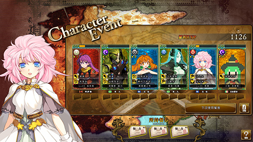

| [角色卡片] | 点击可对该角色使用餐券 最多将显示６张角色卡片 |
|---|---|
| [详情] | 每次点击都将切换卡片上的显示信息 |
| [下次使用餐券] | 餐券可以积攒起来而不立即使用 |
| [帮助] | 显示帮助信息 |

■

---

## 参考 14 设置

> 源文件：`r14.html`

■参考手册

### 14．设置

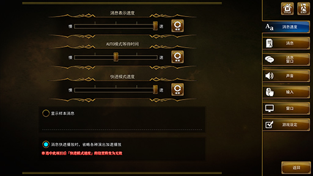

可更改游戏相关设定，如文字显示速度及音量等。

| [消息速度] | 可更改文字显示速度相关设定 |
|---|---|
| [消息] | 可更改文本显示方式相关设定 |
| [消息窗口] | 可更改文字显示时的亮度、不透明度等相关设定 |
| [声音] | 可更改ＢＧＭ相关设定 |
| [输入] | 可更改鼠标操作相关设定 |
| [窗口] | 可更改界面显示相关设定 |
| [游戏设定] | 可更改本游戏特有的其他设定 |
| [TITLE] | 回到游戏启动时的界面 ⇒ [启动界面] |
| [EXIT] | 关闭游戏 |
| [返回] | 回到原来的界面 |

■

---

## 开发人员

> 源文件：`staff.html`

### 开发人员

|  |  |
|---|---|
| 》总监&游戏组建&故事构成 | ：ＴＡＤＡ |
|  |  |
| 》人物原画&怪物原画&助理总监 | ：織音 |
|  |  |
| 》剧本&故事构成&助理总监 | ：ヨイドレ・ドラゴン |
|  |  |
| 》视觉设计&平衡调整&演出效果 | ：ぷりん |
|  |  |
| 》系统ＣＧ&地图 | ：遊喜 |
|  |  |
| 》女孩怪物原画 | ：MIN-NARAKEN |
|  |  |
| 》怪物原画&副原画 | ：たっくん |
|  |  |
| 》剧本 | ：ダイスころがし |
|  |  |
| 》程序&演出效果 | ：DJ C++ |
|  |  |
| 》程序 | ：白牡丹 |
|  |  |
| 》ＣＧ指导 | ：タケペン |
|  |  |
| 》ＣＧ | ：天然水 ：ひさと ：えびちり ：たっくん |
|  |  |
| 》背景策划&推进 | ：なかじー |
|  |  |
| 》背景ＣＧ | ：古介 |
|  |  |
| 》事件ＣＧ背景 | ：れんれん ：古介 |
|  |  |
| 》背景视觉设计协助 | ：平澤晃弘 ：Studio En |
|  |  |
| 》背景协助 | ：有限会社石垣プロダクション ：ART STUDIO画龍 |
|  |  |
| 》脚本 | ：鉄鉱石 ：天雪ハルカ |
|  |  |
| 》特效 | ：慶 |
|  |  |
| 》音乐 | ：水夏える(ASTLYRE) ：PKタートルズ(ASTLYRE) ：DJ C++(ASTLYRE) |
|  |  |
| 》效果音 | ：DJ C++(ASTLYRE) ：PKタートルズ(ASTLYRE) |
|  |  |
| 》印刷品 | ：ひさと |
|  |  |
| 》动画 | ：KIZAWAstudio ：桜秀蘭 ：七薙 |
|  |  |
| 》程序框架 | ：こころ ：やすべ ：らむだ |
|  |  |
| 》马赛克&伦理检查 | ：タケペン ：む～みん |
|  |  |
| 》调试 | ：む～みん ：鉄鉱石 ：天雪ハルカ ：ＢＩＳＯＮ ：破魔矢 ：ALL ALICESOFT STAFF |
|  |  |
| 》字体协助 | ：フォントワークス株式会社 |
|  |  |
| 》营业&宣传&业务 | ：ワタナベ ：桜秀蘭 ：OKAMURA ：macky |
|  |  |
| 》制造&贩卖负责人 | ：しらきんぐ ：ＴＡＤＡ |
|  |  |
| 》中文化程序 | ：见解 |
|  |  |
| 》中文化翻译 | ：Parav ：hikare ：霜月 ：比那名居小江 ：aya ：雪待月 ：N-inu ：SAKANA ：イテツ ：Keroism ：流音 ：Liu XingMing ：Li RunChu ：Jane ：奈良津茂野 ：N.Z. ：不来方 ：pan712 ：Habayashi ：Yang Fan ：老孔 ：Flandra |
|  |  |
| 》中文化校对 | ：Parav ：hikare ：霜月 ：比那名居小江 ：aya ：雪待月 ：钏镯琤瑽 |
|  |  |
| 》中文化美工 | ：修闭口禅的兔子 ：hikare ：比那名居小江 |
|  |  |
| 》中文化测试 | ：hikare ：猫井狸 ：幽灵 ：乌龟 ：Zetubou |
|  |  |
| 》中文化字幕 | ：Parav |
|  |  |

■ ＡＬＩＣＥＳＯＦＴ ■

---

## 版权

> 源文件：`pub.html`

### 版权

剧本　　　　　ＴＡＤＡ

网页制作　　　桜秀蘭

协助　　　　　ALL ALICESOFT STAFF

制作・著作　　ALICESOFT

2018年 2月

©2018 ALICESOFT

※禁止以任何理由复制本指南的全部或部分内容。
　禁止将本指南挪作他用或转载至任何媒体。

■
